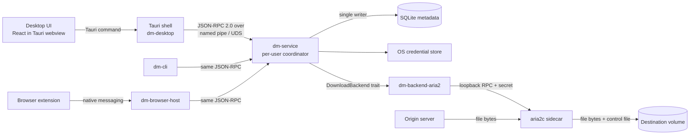

# Architecture

This document is the authoritative description of the system's architecture. Decisions and the alternatives considered are in
[decisions/0001-project-foundation.md](decisions/0001-project-foundation.md). Changing a boundary
described here requires a new ADR (ARCH-10).

Status legend used below: **[exists]** means code is in the repository. **[planned Bn]** means it is specified and
scheduled for milestone Bn.

## 1. Overview

Only the engine moves file bytes: origin server → engine → disk (ARCH-02). Every other edge carries
commands, state and events.

## 2. Processes, ownership and lifecycle

| Process | Owns | Must never |
|---|---|---|
| Desktop UI (webview) [exists] | Presentation, view state, user input | Hold file bytes, open SQLite, reach aria2, read secrets |
| Tauri shell `dm-desktop` [exists, no commands yet] | Window, tray, close-to-tray setting, bridge commands to the service | Stop the service implicitly on window close |
| `dm-service` [exists, B0.2: separate per-user process, in-memory jobs; SQLite B1] | Job IDs, idempotency, queues, schedules, policy, retry classification, secret retrieval, backend lifecycle, SQLite | Pass file bytes through IPC; expose backend handles as job IDs |
| `aria2c` sidecar [planned B0] | Transfer, segment state, `.aria2` control files, session file | Be reachable by anything except `dm-backend-aria2` |
| `dm-browser-host` [planned B2] | Native-messaging framing, sender validation, forwarding | Transfer bytes; keep the service alive or kill it |
| `dm-cli` [exists, B0.3: `dm` executable] | Command-line client of the same API | Implement a second download path |

Lifecycle rules (ARCH-01, ARCH-09):

- The service runs as the current OS user, never elevated. There is one instance per user, enforced by an exclusive lock on the IPC endpoint and the data directory.
- The UI, browser and host can come and go. Their exit never stops transfers. The service exits only on an explicit stop ("Exit and stop downloads", `dm service stop`) or OS logout/shutdown. Before exiting it checkpoints and stops the engine gracefully.
- Startup: the service acquires the lock → opens SQLite (migrations) → starts the engine with a random RPC secret on loopback → reconciles (§6) → accepts IPC.
- The seven lifecycle cases to test are UI close, browser close, host disconnect, service restart, logout, sleep and reboot. Their expected results are in [testing.md](testing.md#5-service-lifecycle-and-cancellation).
- The scheduler acts only while the service runs. Missed windows follow the job's `missed_run_policy`.

## 3. Control flow and data flow

Adding a download from the UI (the CLI and extension use the same path):

1. UI → `ServiceClient` (`apps/desktop/src/services/`) → Tauri command → `downloads.v1.add` over IPC.
2. The service validates the params, checks the idempotency key and creates `job_…`. Any secret goes to the credential store, and only a reference is kept. The service persists the job, then replies with the job snapshot. Replying only after persisting means a lost reply never creates a duplicate.
3. The policy (`dm_domain::decide_run`) declares the job eligible. The service creates `att_…`, checks the required capabilities and calls `DownloadBackend::start`.
4. The adapter maps `att_…` to an aria2 GID internally and supplies the headers for this attempt only, never in the session file.
5. Bytes stream from the origin to disk inside aria2. The service polls or subscribes to progress and publishes coalesced events.
6. Completion journal (ADV06): intent → verify (length/hash) → origin marking/scan → same-volume rename → `completed`.

## 4. Download backend interface and capabilities

Defined in `crates/backend-api/src/lib.rs` (crate `dm-backend-api`, ADR 0002) [exists]. The service and every engine adapter depend on this crate, and never on each other:

- `DownloadBackend` has `id`, `capabilities`, `start`, `pause`, `resume`, `remove`, `discard` and `progress`. Methods return `BackendError { kind: ErrorKind, detail, retry_after }` with the detail already sanitized; `retry_after` carries a server-requested wait when the engine can see it (aria2 cannot). `discard` removes a stopped transfer and deletes its partial output and engine resume state, so a retry starts from zero (B0.4.1).
- `BackendHandle` is opaque and scoped to one attempt. It is never serialized into contracts and never used as a job identity (ARCH-03).
- `capabilities()` returns a report covering every `Capability`. Each entry is `supported`, `unsupported` or `unverified`. Upstream documentation alone yields `unverified`. Only project fixtures promote an entry to `supported` (ARCH-04).
- `require_capability` refuses anything except `supported` with `BACKEND_CAPABILITY_UNAVAILABLE`. Silent fallbacks are forbidden. For example, an unsupported SOCKS5 profile must not connect directly.
- The public API never accepts arbitrary aria2 options.
- **Backend selection ([ADR 0005](decisions/0005-default-backend.md)):** `dm-service --backend http|aria2`, default **`http`**; chosen once per process, no fallback between backends (a backend that cannot start exits with code 4). aria2 is opt-in with its ADR 0003 restrictions and is not bundled while REL-05 is open. `dm-backend-http` (B0.4.2–B0.4.3): HTTP/1.1, rustls with the platform verifier, manual redirects gated per hop by its capability report, credentials and validators scoped to the original origin, identity encoding only, `Retry-After` in `BackendError`, partial data in `<name>.downova-part` published without overwriting. Its report: `Http`, `Https`, `ResumeStrongValidator` (B0.4.2) and `SegmentedHttp` (B0.4.3: ≤ 4 validated segments of ≥ 1 MiB, only with a strong ETag and a length) supported. No connection budget across jobs yet (CORE-02).
- The aria2 adapter owns the engine process through a watcher task that waits on it for its whole life, so an engine that exits for any reason is reaped immediately (no zombie on Unix) and every later call reports `SERVICE_UNAVAILABLE` ("download engine exited unexpectedly"). Shutdown and drop kill through the same watcher.

Known aria2 limits to carry into its report (research §14.4, §16.2): it is HTTP/1.1 only, supports HTTP proxy with Basic auth only (no SOCKS5 or PAC), and its `conditional-get` is If-Modified-Since, which is ignored when a control file exists. That is **not** If-Range resume validation. B0.4 measured the pinned build ([report](reports/b0.4-http-correctness.md), [ADR 0003](decisions/0003-aria2-go-no-go.md)): aria2 never sends If-Range and splices changed resources on resume, forwards `--header` values to cross-origin redirect targets, and ignores Retry-After. The adapter therefore runs `--max-tries=1` and `--continue=false`, refuses credential headers, and reports `Http` supported only under those defaults; `Https` stays unverified, `SegmentedHttp` and `ResumeStrongValidator` unsupported. B0.4.1 showed that a strong-ETag `If-Match` through `--header` cannot change this (a server that ignores it still yields a spliced file, M04), that the pinned Windows build uses WinTLS and ignores CA bundles (the adapter now refuses one), and led to [ADR 0004](decisions/0004-rust-http-backend-prototype.md): a Rust HTTP backend prototype behind the same trait.

## 5. Service API and events

The transport is JSON-RPC 2.0 over a user-only named pipe (Windows) or Unix-domain socket (macOS/Linux) (ARCH-06). The canonical schema is
`packages/contracts/schema/service-api.v1.schema.json` (see §9).

| Method | Behaviour |
|---|---|
| `service.v1.hello` | API version, service version, instance ID, backend capability report |
| `service.v1.shutdown` | Acknowledge, then stop: aria2 shut down, endpoint file removed ("Exit and stop downloads") |
| `downloads.v1.add` | Idempotent add (COR-09) |
| `downloads.v1.list` / `get` | Sanitized, paginated snapshots |
| `downloads.v1.pause` / `resume` / `cancel` | Change `desired_state`; attempt-guarded |
| `downloads.v1.replaceSource` | Re-validate identity; keep or restart (COR-06) |
| `downloads.v1.retry` | New attempt from a retryable stage |
| `rules.v1.*`, `manifests.v1.*`, `diagnostics.v1.*` | Later milestones (B4) |
| `events.v1.subscribe` | Snapshot plus a bounded event stream |

Conventions: IDs are strings, byte counts are decimal strings, and unknown values are `null`. Errors use the JSON-RPC
code plus `error.data = ErrorData { kind, retryable, next_action, detail }`. Mutating calls are always
acknowledged. Request ID correlation is separate from the idempotency key.

Events (ARCH-08): progress events are coalesced at 250–500 ms, and semantic changes are sent immediately. Each event carries
`service_instance_id` and a monotonically increasing `sequence`. A client that sees a gap or a new instance ID
calls `downloads.v1.list` again. Slow subscribers get `snapshot_required` and never back-pressure the
service.

### IPC transport as implemented (B0.2, `crates/platform/src/ipc.rs`)

- **Framing:** one JSON-RPC 2.0 object per line (UTF-8, `\n`). Lines over 1 MiB close the connection, since requests never carry file content.
- **Windows:** named pipe `\\.\pipe\downova-<128-bit random>`.
  - Protected DACL `D:P(A;;GA;;;OW)(A;;GA;;;SY)`: only the object owner and SYSTEM have access. The default pipe DACL would grant Everyone read access, so it is replaced.
  - Remote clients are rejected.
  - The random name prevents other users from predicting and squatting on the pipe.
  - *Limitation:* when the service runs elevated, the owner can be the Administrators group. Running elevated is not supported.
- **Unix:** `<data>/run/downova.sock` inside a 0700 directory. On Linux the socket itself is created with mode 0600 before `bind()`.
- **Discovery:** the service writes `<data>/run/endpoint.json` (user-private, atomic rename). Clients read it. A missing file or a refused connection is reported as `SERVICE_UNAVAILABLE`.
- **Single instance:** an exclusive OS file lock on `<data>/run/service.lock`. A second instance exits with code 3.
- **Authentication:** OS-level only (user-only endpoint + private discovery file). Per-client capabilities are a later addition (ADV10 companion and browser host scope).
- **Errors:** `error.data` is always `ErrorData`. Codes: -32602 invalid params / `INVALID_REQUEST`, -32601 unknown method (no engine passthrough), -32000 other service errors.

## 6. Job identity, attempts, cancellation, retries and recovery

- **Job** (`job_…`): the logical download, stable for its whole life. **Attempt** (`att_…`): one start of the backend. Every backend callback carries an attempt ID, and events from an attempt that is not current are dropped. A late event cannot revive a cancelled job (ADV06).
- **State model** (COR-07, `crates/domain/src/state.rs` [exists]):
  - `desired_state` is one of `running`, `paused` or `cancelled`. Only user commands change it.
  - `phase` is one of `queued`, `probing`, `transferring`, `verifying`, `scanning`, `finalizing`, `completed`, `failed` or `cancelled`.
  - `blockers` is a set of automatic conditions: `offline`, `metered_network`, `schedule_window`, `rate_limit_cooldown`, `disk_unavailable`, `volume_missing` and `queue_limit`.
  - `decide_run` applies this precedence: terminal → cancel → user pause → disk → network/schedule → queue. Clearing blockers never overrides a user pause.
- **Cancel** is acknowledged only after the backend `remove` returns and the attempt is invalidated. Progress is applied only for the job's current attempt and never to a terminal job (B0.2: `crates/service/src/core.rs`, `apply_progress`).
- **Capability gates (B0.2):** `add` requires `Http`/`Https` = `supported`. Segmentation (4 connections) is used only when `SegmentedHttp` is `supported`, otherwise 1. `resume` of a job with partial bytes requires `ResumeStrongValidator` (refused with `choose_restart_or_keep` while it is unsupported).
- **Idempotency (B0.2):** **in-memory only**. It survives lost acknowledgements and retries while the process lives, but not a restart. Durable records arrive in B1 (COR-09).
- **Retry** [exists, B0.4.1, in memory]: owned by the service (`dm_domain::retry`, `Core::after_failure`), never by the engine. Only `NETWORK_OFFLINE` and `SERVER_BUSY` are retried, at most 3 times: after `Retry-After` when the backend reports one (≤ 15 min), otherwise 2 s × 2ⁿ capped at 60 s with equal jitter. The failed attempt is discarded first and a new attempt ID starts from zero. A 429/503 cool-down shows `rate_limit_cooldown`. Authentication failures, `REMOTE_CHANGED`, `LINK_REFRESH_REQUIRED` and `CHECKSUM_MISMATCH` are never retried automatically (COR-04). Durable retry state is B1.
- **Recovery at startup**: for each non-terminal job, the service compares the SQLite job and attempt, the engine session and control file, and the actual partial file. If they agree, the job resumes under the resume rules. If not, it gets an explicit failure or a restart decision. Unfinished journal entries are completed or rolled back from the journal stage, and existing targets are never overwritten.
- **Resume rules** (COR-01..03): append only on a 206 whose Content-Range matches the request, and only with a strong validator. Same size alone is never proof of identity. A 200 response to a range request means a safe restart. Implemented in `dm-backend-http` (B0.4.2): identity fixed by the first 200 (strong ETag, length, final URL), checkpoint = flushed offset + SHA-256 of the partial, resume re-verifies the partial, sends `Range` + `If-Range` to the final URL, and appends a 206 only with the exact `Content-Range`, same ETag and length and identity encoding; weak/missing ETag → resume unavailable. aria2 keeps resume unsupported (ADR 0003).

## 7. SQLite ownership and engine-owned resume state

- **Writer:** `dm-service`, through `dm-storage`, is the only writer (ARCH-05; ADR 0006). The file is `<data>/downova.sqlite3`, opened with `locking_mode=EXCLUSIVE`, so other processes cannot open it while the service runs. The CLI, UI and browser host read through the API.
- **Mode (proposed, to benchmark):** WAL with `synchronous=FULL`. Live progress is never written per packet. Durable checkpoints happen at state changes and on a bounded interval (COR-08).
- **Tables (§18.3):** `jobs`, `attempts`, `resource_identity`, `resume_checkpoints` (a versioned reference to engine state only), `finalization_journal`, `rules`, `schedules`, `network_profiles`, `idempotency_records` and `diagnostics` (sanitized).
- **Byte progress authority:** aria2's control file and session. SQLite never stores a competing segment map. A future custom backend gets its own versioned checkpoint format, and migrating existing partial files is a separate requirement.
- **Migrations:** forward-only and transactional, tracked in `PRAGMA user_version`. On failure the original database is preserved and an actionable repair result is shown. A database from a newer version is refused.
- **State after B1.1** (ADR 0006):
  - Schema v1 has `jobs` and `idempotency_records`; the other tables come later.
  - A job and its key are written in one transaction before `downloads.v1.add` is acknowledged, and state changes are written as they happen.
  - On restart, jobs and keys are restored; idempotency records older than 30 days are pruned.
  - An unfinished job becomes `failed` with an "interrupted" reason, because engine checkpoints are not persisted yet (B1.2).

## 8. OS adapters and browser integration

`dm-platform` [planned] holds every OS-specific behaviour behind small traits:
- IPC endpoint security, credential store, volume identity and free space, and network cost hints
- notifications, MOTW and Attachment Services, autostart, and native-host registration

Each adapter reports `unavailable` instead of guessing.

Browser path (BRW-*):
- The extension (MV3, TypeScript) offers explicit context-menu capture first. Optional automatic capture uses the downloads API with filters, never `webRequestBlocking`.
- The native host is a small Rust binary. It validates sender origin, framing (with a size cap) and payload against the contracts, then forwards to the service.
- Handoff order: request → host → `downloads.v1.add` (idempotency key = extension-generated) → acceptance → only then cancel the browser download. If the host is missing, times out, or the request is unsupported, the browser download continues. POST, blob, data and single-use requests always stay in the browser.
- Registration differs per browser (`allowed_origins` and `allowed_extensions`), OS (registry or manifest path) and channel (store or development ID).

State after B0.6 (spike; [report](reports/b0.6-browser-handoff.md)):
- The host speaks only the closed `NativeHostRequest` contract (`hello`, `add`). `add` becomes `downloads.v1.add` with the extension's idempotency key and profile `downloads`; no other service method is reachable.
- The caller is checked against an exact `allowed_origins` list using the origin the browser passes on the command line, never one claimed in a message.
- The host **never starts the service.** When none is running it answers `unavailable` ("open the Downova app"). On Windows a child of the host would inherit the browser's pipe handles and job object, and preventing that needs unsafe code. Starting the service stays with the desktop app (and, later, login autostart, ARCH-01).
- Outcomes are `accepted`, `rejected`, `unavailable` (nothing was sent) and `uncertain` (sent, no acknowledgement). An `uncertain` hand-off is retried with the same key. The service returns the same job while it keeps running; restart-safe idempotency is B1.
- The extension stores each hand-off with its key in `chrome.storage.local` before sending. A stopped worker or a restarted browser therefore leaves a retryable record, never a lost key.
- The context-menu path never creates a browser download, so there is nothing to cancel. The cancel-after-acceptance order applies to automatic capture (BRW-04, B2).

## 9. Contracts

- The single source is `packages/contracts/schema/service-api.v1.schema.json` (JSON Schema 2020-12).
- TypeScript types are generated by `pnpm contracts:gen` into `packages/contracts/src/generated/`, which is committed and never hand-edited.
- The Rust mirror is the hand-written serde types in `crates/domain/src/api.rs` (and the enums they use).
- Sync is enforced by:
  - `pnpm contracts:check`, which fails on stale generated types or on any example that disagrees with the schema (valid examples must pass, `examples/invalid/` must fail);
  - `cargo test -p dm-domain --test contract_examples`, which fails if Rust cannot round-trip every valid example or accepts an invalid one.
- A breaking change needs a new method version and an ADR.

## 10. Credentials and privacy boundaries

- Secrets include cookies, Authorization headers, proxy passwords and signed query tokens. They live in the OS credential store or in memory for one attempt. In code they are typed `dm_domain::redact::Secret`, which has no `Serialize`, no `Display`, and a redacted `Debug` (SEC-01, SEC-02).
- Anything logged, evented, exported or shown uses `redact_url`, which removes userinfo, query values and fragments. Sensitive headers are filtered by `is_sensitive_header`.
- Passing per-attempt headers to aria2 must not persist them into the aria2 session or config. B0 verifies this with a synthetic-secret test.
- Credential scope is re-checked on every redirect hop and never forwarded to another origin (BRW-05).
- There is no telemetry by default. Diagnostics are local, previewed and opt-in to share.

## 11. Dependency licensing considerations

- aria2 is GPL-2.0-or-later. It is shipped as a separate sidecar executable. Distribution must include its license, notices and the corresponding source or an offer for it. Whether the combination is mere aggregation depends on the integration model, so the project license stays an open decision (ADR 0001, REL-03).
- Optional media helpers (FFmpeg, yt-dlp) have build-dependent licenses and need separate inventory (E01).
- All npm and Cargo versions are pinned exactly and locked (`pnpm-lock.yaml`, `Cargo.lock`). The SBOM and provenance come with ADV09.
