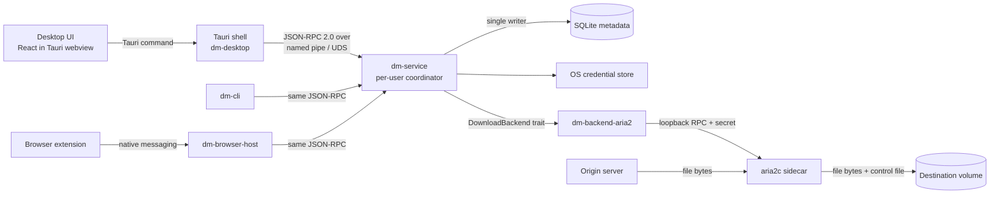

# Architecture

This document is the authoritative description of the system's architecture. Decisions and the alternatives considered are in
[decisions/0001-project-foundation.md](decisions/0001-project-foundation.md). Changing a boundary
described here requires a new ADR (ARCH-10).

Status legend used below: **[exists]** means code is in the repository. **[planned Bn]** means it is specified and
scheduled for milestone Bn.

## 1. Overview

Only the engine moves file bytes: origin server → engine → disk (ARCH-02). Every other edge carries
commands, state and events.

## 2. Processes, ownership and lifecycle

| Process | Owns | Must never |
|---|---|---|
| Desktop UI (webview) [exists] | Presentation, view state, user input | Hold file bytes, open SQLite, reach aria2, read secrets |
| Tauri shell `dm-desktop` [exists, no commands yet] | Window, tray, close-to-tray setting, bridge commands to the service | Stop the service implicitly on window close |
| `dm-service` [exists, B0.2: separate per-user process, in-memory jobs; SQLite B1] | Job IDs, idempotency, queues, schedules, policy, retry classification, secret retrieval, backend lifecycle, SQLite | Pass file bytes through IPC; expose backend handles as job IDs |
| `aria2c` sidecar [planned B0] | Transfer, segment state, `.aria2` control files, session file | Be reachable by anything except `dm-backend-aria2` |
| `dm-browser-host` [planned B2] | Native-messaging framing, sender validation, forwarding | Transfer bytes; keep the service alive or kill it |
| `dm-cli` [exists, B0.3: `dm` executable] | Command-line client of the same API | Implement a second download path |

Lifecycle rules (ARCH-01, ARCH-09):

- The service runs as the current OS user, never elevated. There is one instance per user, enforced by an exclusive lock on the IPC endpoint and the data directory.
- The UI, browser and host can come and go. Their exit never stops transfers. The service exits only on an explicit stop ("Exit and stop downloads", `dm service stop`) or OS logout/shutdown. Before exiting it checkpoints and stops the engine gracefully. "Exit and stop downloads" also persists a manual pause for every running download, so they stay paused until resumed (ADR 0012). Closing the desktop window either hides it to the tray or closes the UI (a desktop setting); neither stops the service. A second desktop launch focuses the existing window.
- Startup: the service acquires the lock → opens SQLite (migrations) → starts the engine with a random RPC secret on loopback → reconciles (§6) → accepts IPC.
- The seven lifecycle cases to test are UI close, browser close, host disconnect, service restart, logout, sleep and reboot. Their expected results are in [testing.md](testing.md#5-service-lifecycle-and-cancellation).
- The scheduler acts only while the service runs. Missed windows follow the job's `missed_run_policy`.

The lifecycle cases as implemented (B2.10, ADR 0016). "Tested" means simulated or process-level tests; real OS
events are human tests.

| Case | Behaviour | Evidence |
|---|---|---|
| UI close | Hide to tray or close the window (setting); the service and transfers continue; a second launch focuses the window | packaged smoke C, G1–G3 (B2.2) |
| Browser close / native-host disconnect | The host forwards one add and exits. A disconnect before or after the acknowledgement leaves exactly one job, because a retry reuses the idempotency key | `host_disconnects_before_and_after_the_acknowledgement_leave_one_job` |
| Service restart with the UI open | The window loses its stream, probes for a running service (attach-only, at most 6 attempts over about 23 s), then re-subscribes for a fresh snapshot of the new instance. It never starts the service itself and never replays an uncertain mutation; afterwards it offers **Reconnect** | UI `batch-live` lifecycle tests; process `the_event_stream_ends_with_the_service_and_restarts_with_a_new_instance` |
| Exit and stop downloads | The window ends its stream and disables reconnection first; the shell only probes once exiting began. A graceful stop checkpoints transfers within 10 s (`SHUTDOWN_CHECKPOINT_BOUND`) | UI exit test; packaged smoke (B2.2) |
| Sleep / wake | A wall-clock jump of more than 30 s past the poll interval counts as a wake: disk and drive holds are re-checked and network-retry waits become due. Server cool-downs, manual pauses and stopped queues keep their state | service wake tests (simulated clock jump); **real OS sleep not run** |
| Logout | The per-user service ends with the session like any user process. Transfers stop at their last checkpoint (at most 2 s old). There is no login autostart: reopening Downova starts the service, which recovers unfinished downloads from their checkpoints; manual pauses and stopped queues persist | process kill tests (B1.2); **real logout not run** |
| Reboot | As logout. Nothing runs while the computer is off; downloads continue when the user opens Downova again | process kill tests; **real reboot not run** |

## 3. Control flow and data flow

Adding a download from the UI (the CLI and extension use the same path):

1. UI → `ServiceClient` (`apps/desktop/src/services/`) → Tauri command → `downloads.v1.add` over IPC.
2. The service validates the params, checks the idempotency key and creates `job_…`. Any secret goes to the credential store, and only a reference is kept. The service persists the job, then replies with the job snapshot. Replying only after persisting means a lost reply never creates a duplicate.
3. The policy (`dm_domain::decide_run`) declares the job eligible. The service creates `att_…`, checks the required capabilities and calls `DownloadBackend::start`.
4. The adapter maps `att_…` to an aria2 GID internally and supplies the headers for this attempt only, never in the session file.
5. Bytes stream from the origin to disk inside aria2. The service polls or subscribes to progress and publishes coalesced events.
6. Completion journal (ADV06): intent → verify (length/hash) → origin marking/scan → same-volume rename → `completed`.

### Desktop shell bridge (B2.1, `apps/desktop/src-tauri/src/downloads.rs`)

- **Command surface:** `service_connect` plus five fixed commands: `downloads_list`, `downloads_add`,
  `downloads_pause`, `downloads_resume` and `downloads_cancel`. `build.rs` declares exactly these in the app manifest,
  and `capabilities/default.json` grants each one by name. There is no generic RPC forwarding and no filesystem,
  SQLite or backend access from React.
- **Arguments:** checked in Rust before anything is sent: an http(s) link without credentials, spaces or control
  characters and at most 8 KiB (`dm_domain::validate`, shared with the browser host); an 8–128 character token key; a
  `job_…` ID. Add always uses destination profile `downloads`.
- **Transport:** each command opens the private endpoint with the shared `dm-platform` client: connect ≤ 3 s, list
  ≤ 5 s, mutation acknowledgement ≤ 15 s. It answers with the contract types.
- **Failures:** `{ outcome, error: ErrorData }`, where the outcome is one of:
  - `unavailable`: nothing was sent;
  - `uncertain`: a mutation was sent but not acknowledged;
  - `rejected`: the service or the argument check refused it.

  The UI never repeats a mutation by itself. A user retry of an uncertain add reuses the same idempotency key, so the
  service returns the same job.
- **UI updates:** the UI polls `downloads_list` about once a second, never overlapping. It drops answers from an older
  connection and lists that started before the latest acknowledged mutation. When the service is unreachable it stops
  polling and keeps the last rows marked as possibly out of date until the user reconnects (`service_connect` finds or
  starts the service). Event forwarding (ARCH-08) replaces polling later.

- **B2.16–B2.19 commands:** `downloads_retry`, `downloads_replace_source` (typed, validated before sending; an
  uncertain answer is repeated with the same operation ID), `downloads_reveal` and `folder_pick`. The last two are the
  only users of the dialog and opener plugins, through `folders.rs` (ADR 0021); the webview is granted no plugin
  permission, and `downloads_reveal` takes only a job ID — the folder comes from `downloads.v1.locate`.

## 4. Download backend interface and capabilities

Defined in `crates/backend-api/src/lib.rs` (crate `dm-backend-api`, ADR 0002) [exists]. The service and every engine adapter depend on this crate, and never on each other:

- `DownloadBackend` has `id`, `capabilities`, `start`, `pause`, `resume`, `remove`, `discard` and `progress`. Methods return `BackendError { kind: ErrorKind, detail, retry_after }` with the detail already sanitized; `retry_after` carries a server-requested wait when the engine can see it (aria2 cannot). `discard` removes a stopped transfer and deletes its partial output and engine resume state, so a retry starts from zero (B0.4.1).
- `BackendHandle` is opaque and scoped to one attempt. It is never serialized into contracts and never used as a job identity (ARCH-03).
- `capabilities()` returns a report covering every `Capability`. Each entry is `supported`, `unsupported` or `unverified`. Upstream documentation alone yields `unverified`. Only project fixtures promote an entry to `supported` (ARCH-04).
- `require_capability` refuses anything except `supported` with `BACKEND_CAPABILITY_UNAVAILABLE`. Silent fallbacks are forbidden. For example, an unsupported SOCKS5 profile must not connect directly.
- The public API never accepts arbitrary aria2 options.
- **Backend selection ([ADR 0005](decisions/0005-default-backend.md)):** `dm-service --backend http|aria2`, default **`http`**; chosen once per process, no fallback between backends (a backend that cannot start exits with code 4). aria2 is opt-in with its ADR 0003 restrictions and is not bundled while REL-05 is open. `dm-backend-http` (B0.4.2–B0.4.3): HTTP/1.1, rustls with the platform verifier, manual redirects gated per hop by its capability report, credentials and validators scoped to the original origin, identity encoding only, `Retry-After` in `BackendError`, partial data in `<name>.downova-part` published without overwriting. Its report: `Http`, `Https`, `ResumeStrongValidator` (B0.4.2) and `SegmentedHttp` (B0.4.3: ≤ 4 validated segments of ≥ 1 MiB, only with a strong ETag and a length) supported. No connection budget across jobs yet (CORE-02).
- The aria2 adapter owns the engine process through a watcher task that waits on it for its whole life, so an engine that exits for any reason is reaped immediately (no zombie on Unix) and every later call reports `SERVICE_UNAVAILABLE` ("download engine exited unexpectedly"). Shutdown and drop kill through the same watcher.

Known aria2 limits to carry into its report (research §14.4, §16.2): it is HTTP/1.1 only, supports HTTP proxy with Basic auth only (no SOCKS5 or PAC), and its `conditional-get` is If-Modified-Since, which is ignored when a control file exists. That is **not** If-Range resume validation. B0.4 measured the pinned build ([report](reports/b0.4-http-correctness.md), [ADR 0003](decisions/0003-aria2-go-no-go.md)): aria2 never sends If-Range and splices changed resources on resume, forwards `--header` values to cross-origin redirect targets, and ignores Retry-After. The adapter therefore runs `--max-tries=1` and `--continue=false`, refuses credential headers, and reports `Http` supported only under those defaults; `Https` stays unverified, `SegmentedHttp` and `ResumeStrongValidator` unsupported. B0.4.1 showed that a strong-ETag `If-Match` through `--header` cannot change this (a server that ignores it still yields a spliced file, M04), that the pinned Windows build uses WinTLS and ignores CA bundles (the adapter now refuses one), and led to [ADR 0004](decisions/0004-rust-http-backend-prototype.md): a Rust HTTP backend prototype behind the same trait.

## 5. Service API and events

The transport is JSON-RPC 2.0 over a user-only named pipe (Windows) or Unix-domain socket (macOS/Linux) (ARCH-06). The canonical schema is
`packages/contracts/schema/service-api.v1.schema.json` (see §9).

| Method | Behaviour |
|---|---|
| `service.v1.hello` | API version, service version, instance ID, backend capability report |
| `service.v1.shutdown` | `{ mode? }` (ADR 0012): `keep_state` (default, Ctrl+C) stops and checkpoints transfers, which continue after the next start; `pause_downloads` ("Exit and stop downloads") first pauses every running download durably. Answers `{ mode, paused_jobs }`, then stops (engine shut down, endpoint file removed). A rejected request never stops the service |
| `downloads.v1.add` | Idempotent add (COR-09) |
| `downloads.v1.list` / `get` | Sanitized, paginated snapshots |
| `downloads.v1.pause` / `resume` / `cancel` | Change `desired_state`; attempt-guarded |
| `downloads.v1.retry` | A failed job starts again from zero as the same job (B2.16, ADR 0020); `discard_partial` confirms discarding partial data; durable `operation_id`, optional `expected_attempt_id` |
| `downloads.v1.replace_source` | Refresh link (B2.17, ADR 0020): keeps progress only with a backend proof, otherwise `choice_required` with a reason and no change; `restart` is explicit |
| `downloads.v1.locate` | A job's bound folder and, once completed, its file (B2.19), for the user-triggered Open containing folder (ADR 0021) |
| `notifications.v1.get` / `set` | CORE-09 (ADR 0022): `{ enabled, locale }`, off by default; the service decides once per durable terminal outcome and shows it through the platform adapter, also with the window closed |
| `rules.v1.*`, `manifests.v1.*`, `diagnostics.v1.*` | Later milestones (B4) |
| `downloads.v1.check` | Same-link jobs (B2.8, ADR 0015); never returns the URL |
| `downloads.v1.confirm_name` | Accept the free name of a job held by `name_conflict` |
| `downloads.v1.set_queue` / `set_priority` / `move` | Queue membership, priority, manual order (B2.11, ADR 0017) |
| `concurrency.v1.get` / `set` | Persist the global active-file maximum (1–16, default 3); queue and backend limits still apply; lowering never preempts |
| `settings.v1.get` / `set` | Destination rules and collision policy; folders validated by the service |
| `queues.v1.list` / `create` / `rename` / `set_limit` / `delete` / `start` / `stop` | Persistent queues; delete never deletes jobs or files |
| `events.v1.subscribe` | Snapshot plus a bounded event stream (B2.9, ADR 0016) |
| `history.v1.get` / `set` / `preview` / `clean` | History retention (B2.12, ADR 0018): list entries only, never files |

Conventions: IDs are strings, byte counts are decimal strings, and unknown values are `null`. Errors use the JSON-RPC
code plus `error.data = ErrorData { kind, retryable, next_action, detail }`. Mutating calls are always
acknowledged.

Error semantics (CORE-11, B1.7):
- `retryable` means the cause is transient. Automatic retries are a separate service policy: transfer retries for
  `NETWORK_OFFLINE` and `SERVER_BUSY`, and the disk recheck for waiting jobs.
- `next_action` is the user's step.
- Clients pick localized text from `kind` and `next_action` (desktop: `error.*` in `i18n/messages.ts`; CLI:
  `explain` / `hint`). They never parse the English `detail`.
- A failed job never resumes. `downloads.v1.retry` starts it again from zero as the same job, and
  `downloads.v1.replace_source` gives a paused or failed job a new link (ADR 0020). Adding the link again still
  creates a separate job.
- The per-kind audit is in the [B1.7 report](reports/b1.7-error-catalogue.md). Request ID correlation is separate from the idempotency key.

Events (ARCH-08, implemented in B2.9, ADR 0016):
- `events.v1.subscribe` answers with a snapshot and its sequence; `events.v1.event` notifications follow on the same
  connection, each line written whole.
- Progress is diff-coalesced every 400 ms; semantic changes are published when a mutation finishes.
- Each event carries `service_instance_id`, the next `sequence` (a decimal string) and the job and attempt IDs.
- A client that sees a gap, a new instance ID or `snapshot_required` subscribes again for a fresh snapshot.
- Each subscriber buffers at most 1024 events. A full buffer drops it with `snapshot_required`, so a slow subscriber
  never back-pressures the service.
- The desktop polls `downloads.v1.list` only when a service refuses the subscription as unknown
  (`INVALID_REQUEST`). Any other refusal (for example a list larger than the window accepts) stops in a reported
  state until the user reconnects (B2.24).
- The window applies events in per-job batches: within 50 ms when visible, at most once per second when hidden, and
  at once before any mutation acknowledgement and on becoming visible. A fresh snapshot drops the queued batch.
  Three stream restarts in a row are immediate; further ones, while no event is applied in between, back off from
  500 ms up to 8 s (B2.24).

### IPC transport as implemented (B0.2, `crates/platform/src/ipc.rs`)

- **Framing:** one JSON-RPC 2.0 object per line (UTF-8, `\n`). The service closes a connection whose request line exceeds 1 MiB, since requests never carry file content. Clients accept response and notification lines up to 64 MiB from their own user's service (B2.22: a 10,000-job list or snapshot is about 5 MiB and could never load under the former shared 1 MiB bound). A longer line is the typed, non-retryable `CallError::TooLarge` (B2.24): the window reports it and stops instead of reconnecting, and a peer that stops inside a line is a lost connection. Reads are bounded by the limit, never by a newline that may not come.
- **Windows:** named pipe `\\.\pipe\downova-<128-bit random>`.
  - Protected DACL `D:P(A;;GA;;;OW)(A;;GA;;;SY)`: only the object owner and SYSTEM have access. The default pipe DACL would grant Everyone read access, so it is replaced.
  - Remote clients are rejected.
  - The random name prevents other users from predicting and squatting on the pipe.
  - *Limitation:* when the service runs elevated, the owner can be the Administrators group. Running elevated is not supported.
- **Unix:** `<data>/run/downova.sock` inside a 0700 directory. On Linux the socket itself is created with mode 0600 before `bind()`.
- **Discovery:** the service writes `<data>/run/endpoint.json` (user-private, atomic rename). Clients read it. A missing file or a refused connection is reported as `SERVICE_UNAVAILABLE`.
- **Single instance:** an exclusive OS file lock on `<data>/run/service.lock`. A second instance exits with code 3.
- **Authentication:** OS-level only (user-only endpoint + private discovery file). Per-client capabilities are a later addition (ADV10 companion and browser host scope).
- **Errors:** `error.data` is always `ErrorData`. Codes: -32602 invalid params / `INVALID_REQUEST`, -32601 unknown method (no engine passthrough), -32000 other service errors.

## 6. Job identity, attempts, cancellation, retries and recovery

- **Job** (`job_…`): the logical download, stable for its whole life. **Attempt** (`att_…`): one start of the backend. Every backend callback carries an attempt ID, and events from an attempt that is not current are dropped. A late event cannot revive a cancelled job (ADV06).
- **State model** (COR-07, `crates/domain/src/state.rs` [exists]):
  - `desired_state` is one of `running`, `paused` or `cancelled`. Only user commands change it.
  - `phase` is one of `queued`, `probing`, `transferring`, `verifying`, `scanning`, `finalizing`, `completed`, `failed` or `cancelled`.
  - `blockers` is a set of automatic conditions: `offline`, `metered_network`, `schedule_window`, `rate_limit_cooldown`, `disk_unavailable`, `volume_missing` and `queue_limit`.
  - `decide_run` applies this precedence: terminal → cancel → user pause → disk → network/schedule → queue. Clearing blockers never overrides a user pause.
- **Cancel** is acknowledged only after the backend `remove` returns and the attempt is invalidated. Progress is applied only for the job's current attempt and never to a terminal job (B0.2: `crates/service/src/core.rs`, `apply_progress`).
- **Capability gates (B0.2):** `add` requires `Http`/`Https` = `supported`. Segmentation (4 connections) is used only when `SegmentedHttp` is `supported`, otherwise 1. `resume` of a job with partial bytes requires `ResumeStrongValidator` (refused with `choose_restart_or_keep` while it is unsupported).
- **Idempotency (B0.2):** **in-memory only**. It survives lost acknowledgements and retries while the process lives, but not a restart. Durable records arrive in B1 (COR-09).
- **Explicit Retry and Refresh link** (B2.16/B2.17, ADR 0020): user operations on the same job, each with a durable
  operation identity (migration 8) committed with its change. Retry releases the old attempt's partial output
  (`discard`, or `discard_output` for a leftover of an earlier run) before the reopen is committed and starts a
  fresh attempt through normal admission. A refreshed link keeps progress only after `verify_replacement` proved
  the same content (strong ETag, length, a validated `206` of the last confirmed bytes equal to the bytes on disk)
  and the resource is the same or a trusted SHA-256 covers it.
- **Automatic retry** [exists, B0.4.1, in memory]: owned by the service (`dm_domain::retry`, `Core::after_failure`), never by the engine. Only `NETWORK_OFFLINE` and `SERVER_BUSY` are retried, at most 3 times: after `Retry-After` when the backend reports one (≤ 15 min), otherwise 2 s × 2ⁿ capped at 60 s with equal jitter. The failed attempt is discarded first and a new attempt ID starts from zero. A 429/503 cool-down shows `rate_limit_cooldown`. Authentication failures, `REMOTE_CHANGED`, `LINK_REFRESH_REQUIRED` and `CHECKSUM_MISMATCH` are never retried automatically (COR-04). Durable retry state is B1.
- **Recovery at startup**: for each non-terminal job, the service compares the SQLite job and attempt, the engine session and control file, and the actual partial file. If they agree, the job resumes under the resume rules. If not, it gets an explicit failure or a restart decision. Unfinished journal entries are completed or rolled back from the journal stage, and existing targets are never overwritten.
- **Resume rules** (COR-01..03): append only on a 206 whose Content-Range matches the request, and only with a strong validator. Same size alone is never proof of identity. A 200 response to a range request means a safe restart. Implemented in `dm-backend-http` (B0.4.2): identity fixed by the first 200 (strong ETag, length, final URL), checkpoint = flushed offset + SHA-256 of the partial, resume re-verifies the partial, sends `Range` + `If-Range` to the final URL, and appends a 206 only with the exact `Content-Range`, same ETag and length and identity encoding; weak/missing ETag → resume unavailable. aria2 keeps resume unsupported (ADR 0003).

## 7. SQLite ownership and engine-owned resume state

- **Writer:** `dm-service`, through `dm-storage`, is the only writer (ARCH-05; ADR 0006). The file is `<data>/downova.sqlite3`, opened with `locking_mode=EXCLUSIVE`, so other processes cannot open it while the service runs. The CLI, UI and browser host read through the API.
- **Mode (proposed, to benchmark):** WAL with `synchronous=FULL`. Live progress is never written per packet. Durable checkpoints happen at state changes and on a bounded interval (COR-08).
- **Tables (§18.3):** `jobs`, `attempts`, `resource_identity`, `resume_checkpoints` (a versioned reference to engine state only), `finalization_journal`, `rules`, `schedules`, `network_profiles`, `idempotency_records` and `diagnostics` (sanitized).
- **Byte progress authority:** aria2's control file and session. SQLite never stores a competing segment map. A future custom backend gets its own versioned checkpoint format, and migrating existing partial files is a separate requirement.
- **Migrations:** forward-only and transactional, tracked in `PRAGMA user_version`. On failure the original database is preserved and an actionable repair result is shown. A database from a newer version is refused.
- **State after B2.21–B2.23** (ADR 0022; migration 9): `jobs.notify_state` (`NULL`/`sent`/`skipped`) records the
  notification decision once per outcome (cleared by an explicit reopen); jobs finished before the upgrade are
  `skipped`. Settings keys `notifications_enabled` and `notifications_locale`.
- **State after B2.15–B2.20** (ADR 0020; migration 8):
  - `operations` holds explicit Retry/Refresh-link operations (id, kind, job, fingerprint, outcome), written in
    the same transaction as their change and pruned with the idempotency records.
  - `Store::reopen_job` is the only path that clears `finished_at_ms` (amends ADR 0018);
    `Store::replace_source_kept` commits the new source, the rebound checkpoint and the operation together.
- **State after B2.12** (ADR 0018; migration 7):
  - `jobs.finished_at_ms` is stamped once at the first terminal write. Legacy finished rows count from the upgrade.
  - The history retention policy is its own settings key. Service sweeps (startup, every 60 s, batches of 100) remove due list entries through the durable tombstone; files are never touched.
- **State after B2.8–B2.11** (ADR 0015–0017; migration 6):
  - `queues` (`main` always present), `destination_rules` and `settings` tables.
  - Each job has `queue_id`, `priority`, `queue_position`, `category` and `name_confirmed`. Existing jobs joined
    `main` at normal priority in acceptance order.
  - Every queue and settings mutation is persisted before it is acknowledged.
  - Admission follows priority, then queue order, then manual position, then acceptance, under the configured global limit (default 3) and each
    queue's `max_active`.
- **State after B1.6** (ADR 0011):
  - Each job has a fixed **staging name**, chosen at acceptance. Partial and control files, checkpoints and the journal bind to it.
  - Each job also has a **final name** (`display_name`), provisional until frozen. It is frozen when the backend first reports response metadata (`BackendProgress.naming`: the unparsed `Content-Disposition` and the final URL segment), or at the journal intent at the latest.
  - The service parses (RFC 6266/8187), sanitizes, fits (255 UTF-16 units on Windows, 255 UTF-8 bytes elsewhere, with a 24-unit suffix reserve) and de-duplicates the final name. Migration 4 stores `staging_name` and `name_source`.
  - File-system refusals are reported as `DESTINATION_UNWRITABLE`.
- **State after B1.5** (ADR 0010):
  - `dm-backend-http` holds one per-host permit (8 per host, shared by all attempts) for every request from before it is sent until its body is dropped: probes, transfers, resumed ranges, segment workers and each redirect hop. It keeps no idle pooled connections.
  - The service admits up to the saved global active-file limit (1–16, default 3; ADR 0023), subject to queue priority and order. Waiting jobs show `queued` + `queue_limit`. Admission never waits, and recovered jobs are admitted within the limits after a restart.
- **State after B1.4** (ADR 0009):
  - `dm-platform::space` probes free space (`fs4`); `dm-service` turns it into an advisory `SpaceGuard` (remaining bytes plus a 64 MiB margin), which backends receive through their config.
  - `DISK_FULL`/`VOLUME_MISSING` hold a job with the `disk_unavailable`/`volume_missing` blocker. Its last durable checkpoint is committed, its partial file kept and its desired state unchanged, and it continues through validated restore once the budget fits.
  - Finalization's copy fallback is budgeted and waits at `verified`.
- **State after B1.3** (ADR 0008):
  - A backend no longer places files: `Complete` means a synced, staged output (`<name>.downova-part`, same directory).
  - The service finalizes through `finalization_journal` (migration 3): intent → verified (length, SHA-256, trusted checksum) → placed (hard link or exclusive-create copy, never over an existing file) → complete. Each stage is committed with the job row, and `completed` is committed together with the verification evidence.
  - At startup, unfinished entries are reconciled before checkpoint recovery, re-checking every file by SHA-256.
  - aria2 places its own output (`placement = engine`): verification is in place, after the file is visible.
- **State after B1.2** (ADR 0007):
  - Migration 2 adds `jobs.attempt_id` and `resume_checkpoints` (the backend's versioned, opaque checkpoint of the current attempt).
  - A checkpoint is committed with its job row in one transaction (on pause, every 2 s while transferring if it grew, at graceful shutdown) and only after the backend synced the bytes it describes.
  - Stale attempts are refused, and a checkpoint is deleted when the job finishes or moves to another attempt.
  - On restart the backend re-verifies the confirmed regions by SHA-256 and the job continues under a new attempt through the validated range path; anything it cannot verify fails explicitly.
  - aria2 reports `durable_resume` unsupported.
- **State after B1.1** (ADR 0006):
  - Schema v1 has `jobs` and `idempotency_records`; the other tables come later.
  - A job and its key are written in one transaction before `downloads.v1.add` is acknowledged, and state changes are written as they happen.
  - On restart, jobs and keys are restored; idempotency records older than 30 days are pruned.
  - An unfinished job becomes `failed` with an "interrupted" reason, because engine checkpoints are not persisted yet (B1.2).

## 8. OS adapters and browser integration

`dm-platform` [planned] holds every OS-specific behaviour behind small traits:
- IPC endpoint security, credential store, volume identity and free space, and network cost hints
- notifications, MOTW and Attachment Services, autostart, and native-host registration

Each adapter reports `unavailable` instead of guessing.

Browser path (BRW-*):
- The extension (MV3, TypeScript) offers explicit context-menu capture first. Optional automatic capture uses the downloads API with filters, never `webRequestBlocking`.
- The native host is a small Rust binary. It validates sender origin, framing (with a size cap) and payload against the contracts, then forwards to the service.
- Handoff order: request → host → `downloads.v1.add` (idempotency key = extension-generated) → acceptance → only then cancel the browser download. If the host is missing, times out, or the request is unsupported, the browser download continues. POST, blob, data and single-use requests always stay in the browser.
- Registration differs per browser (`allowed_origins` and `allowed_extensions`), OS (registry or manifest path) and channel (store or development ID).
- Registration is per user and ownership-checked (ADR 0014): an entry is this installation's only when its manifest names `com.downova.host` **and** this installation's host path. The NSIS installer and the desktop's first launch (sibling `dm-browser-host register`, never a crate dependency) register Chrome and Edge; uninstall removes only owned entries. Root package scripts write nothing per user.

State after B0.6 (spike; [report](reports/b0.6-browser-handoff.md)):
- The host speaks only the closed `NativeHostRequest` contract (`hello`, `add`). `add` becomes `downloads.v1.add` with the extension's idempotency key and profile `downloads`; no other service method is reachable.
- The caller is checked against an exact `allowed_origins` list using the origin the browser passes on the command line, never one claimed in a message.
- The host **never starts the service.** When none is running it answers `unavailable` ("open the Downova app"). On Windows a child of the host would inherit the browser's pipe handles and job object, and preventing that needs unsafe code. Starting the service stays with the desktop app (and, later, login autostart, ARCH-01).
- Outcomes are `accepted`, `rejected`, `unavailable` (nothing was sent) and `uncertain` (sent, no acknowledgement). An `uncertain` hand-off is retried with the same key. The service returns the same job while it keeps running; restart-safe idempotency is B1.
- The extension stores each hand-off with its key in `chrome.storage.local` before sending. A stopped worker or a restarted browser therefore leaves a retryable record, never a lost key.
- The context-menu path never creates a browser download, so there is nothing to cancel. The cancel-after-acceptance order applies to automatic capture (BRW-04, B2).

State after B2.13 (automatic capture, ADR 0019):
- **Opt-in.** Off by default. Turning it on requests the optional `downloads` and `webRequest` permissions; each site the user adds requests that site's origins. No broad host access at install, no `webRequestBlocking`, no cookie API.
- **Evidence.** Non-blocking `webRequest` observations in `storage.session` record method, header **names** (Cookie, Authorization), redirect hosts and status. A `downloads.onCreated` item is captured only with one matching GET, no cookies or credentials, status 200, every hop on the site list, not incognito, `danger: safe` after filename determination, not an executable type, and passing the filters. Everything else stays in the browser with a reason.
- **State machine** in `storage.local`. The record and its idempotency key are written before the add; duplicate events, worker restarts and lost acknowledgements reuse them (one job per browser download). `downloads.cancel` runs only after a matching acceptance and a recheck; history is never erased and files are never removed.
- **Support matrix** (real Chrome 156 / Edge 156, Windows):

  | Download | Result |
  |---|---|
  | Plain public GET from an allowed site | Captured: accepted, then the browser copy cancelled |
  | POST/form export | Browser |
  | blob:, data: | Browser |
  | Cookie or credential-carrying request | Browser |
  | Redirect outside the sites, ambiguous or missing evidence | Browser |
  | Browser-flagged, executable or installer | Browser |
  | Private window | Browser (capture not available) |
  | Downova missing, down, rejecting or not confirming | Browser keeps downloading |

- **Privacy.** Nothing leaves the computer: the extension talks only to the native host. Request header values, cookies and signed query values are never stored. The activity list shows `scheme://host/path?…`. Incognito stays `not_allowed` (BRW-10 gap: no ephemeral service history).

## 9. Contracts

- The single source is `packages/contracts/schema/service-api.v1.schema.json` (JSON Schema 2020-12).
- TypeScript types are generated by `pnpm contracts:gen` into `packages/contracts/src/generated/`, which is committed and never hand-edited.
- The Rust mirror is the hand-written serde types in `crates/domain/src/api.rs` (and the enums they use).
- Sync is enforced by:
  - `pnpm contracts:check`, which fails on stale generated types or on any example that disagrees with the schema (valid examples must pass, `examples/invalid/` must fail);
  - `cargo test -p dm-domain --test contract_examples`, which fails if Rust cannot round-trip every valid example or accepts an invalid one.
- A breaking change needs a new method version and an ADR.

## 10. Credentials and privacy boundaries

- Secrets include cookies, Authorization headers, proxy passwords and signed query tokens. They live in the OS credential store or in memory for one attempt. In code they are typed `dm_domain::redact::Secret`, which has no `Serialize`, no `Display`, and a redacted `Debug` (SEC-01, SEC-02).
- Anything logged, evented, exported or shown uses `redact_url`, which removes userinfo, query values and fragments. Sensitive headers are filtered by `is_sensitive_header`.
- Passing per-attempt headers to aria2 must not persist them into the aria2 session or config. B0 verifies this with a synthetic-secret test.
- Credential scope is re-checked on every redirect hop, retry, resume and segment, and never forwarded to another origin or downgraded to http (BRW-05, see the B3.3 section below).
- There is no telemetry by default. Diagnostics are local, previewed and opt-in to share.

## 11. Dependency licensing considerations

- aria2 is GPL-2.0-or-later. It is shipped as a separate sidecar executable. Distribution must include its license, notices and the corresponding source or an offer for it. Whether the combination is mere aggregation depends on the integration model, so the project license stays an open decision (ADR 0001, REL-03).
- Optional media helpers (FFmpeg, yt-dlp) have build-dependent licenses and need separate inventory (E01).
- All npm and Cargo versions are pinned exactly and locked (`pnpm-lock.yaml`, `Cargo.lock`). The SBOM and provenance come with ADV09.

## Configurable concurrency (ADR 0023)

The service persists its global maximum separately from destination settings, loads it before recovery,
and admits waiting jobs after a successful increase. Existing queue limits remain unchanged. Native
HTTP validated segments rotate requests under host contention after up to 1 MiB of further data plus
one received chunk, flushing and syncing before releasing their permit; remaining ranges are fully
validated again. Uncontended transfers keep their original requests. The eight-connection host budget
is unchanged. Non-range streams are not preempted; the optional aria2 backend retains its three-file
cap. See [ADR 0023](decisions/0023-configurable-concurrency-and-request-rotation.md).

## Bandwidth limits (ADR 0024, B3.1)

The native HTTP engine owns two token buckets per transfer: the service-wide one and the download's own (shared by
its segments). Each write is split into parts no larger than the smaller burst and charged to the job bucket, then
the global one; waits are dropped futures, so pause, cancel and shutdown end them at once. The per-read timeout is the
engine's (`transfer::within` around each send and body read), never reqwest's, so token waits are not network
silence. The service persists the global limit (settings) and each job's limit (migration 10), applies the global
limit to the backend before recovery, and passes a job's limit on every attempt (`TransferRequest.rate_limit`).
Backends without `speed_limit_*` = `supported` refuse limits with `BACKEND_CAPABILITY_UNAVAILABLE`; aria2 is
`unverified`. File bytes still flow engine → disk only.

## Queue schedules (ADR 0025, B3.1)

`dm-domain::schedule` evaluates a queue's schedule purely from an instant and an IANA zone (`jiff`). The service keeps
one `SchedRuntime` per scheduled queue, evaluates them at the start of every poll (≤ 60 s apart) and on wake, before
admission, and sets or clears the `schedule_window` policy blocker; `desired_state` is never touched. At a window's
end a job with a durable checkpoint is paused like a queue stop; one without is allowed to finish. Schedules, the
last evaluation time and an open catch-up window are stored on `queues` (migration 11) and restored before
recovery. The service's wall clock is injectable (`Core::with_clock`) for deterministic tests.

## Attachment check and diagnostics (ADR 0026, B3.2)

The finalization journal gains an attachment check between `placed` and `complete`. `dm-platform::attachment`
wraps `dm-win-attachment` (the workspace's only unsafe code: `IAttachmentExecute::Save`, volume stream support, file
identity). The service starts the check on a dedicated STA thread behind a 2-permit semaphore, outside the coordinator
lock, and collects the result in the poll loop; a revoked ticket drops late results. The placed file's identity and
SHA-256 are re-verified before an outcome is committed with `complete` (or the `SCAN_BLOCKED` failure). Only the
sanitized origin (`scheme://host[:port]/`) reaches the OS. Diagnostics are built by the service from an allowlist of
typed fields, checked by `export_leaks`, previewed, and exported byte-identically by the service to a path the shell's
save dialog chose; the webview never sees the path.

## Secrets, the credential store and signed-in downloads (ADR 0027, B3.3)

`dm-platform::vault` is the one OS credential-store seam (store, resolve, replace, delete): Windows Credential
Manager, macOS Keychain and the Linux Secret Service through keyring-core stores, namespaced
`Downova/<sha256(data folder)[:12]>`. The service holds it; vault calls run on blocking threads, never under the
coordinator lock. Two kinds of secret are persisted there and nowhere else: a 32-byte data key and remembered
sign-ins. With the data key, `dm-storage` seals protected link parts (userinfo, query, fragment; the whole URL of a
signed-in job) and checkpoint payloads with AES-256-GCM (AAD binds the job id); the plain `jobs.url` column holds
only a display form. Without the key these parts stay in memory and a restart asks for a new link or sign-in.

A signed-in download starts with one explicit browser action. The extension requests the optional `cookies`
permission and that one https origin in the click, reads that link's unpartitioned cookies from the tab's single
cookie store, and sends `add_authenticated` once; extension storage keeps only the origin, store id, browser and
remember choice. The native host checks https, origin equality and bounds and forwards to
`downloads.v1.add_authenticated`. The service binds the session to `cred_<16 hex>` (opaque, from the idempotency key
and origin), keeps it in memory (temporary: until its jobs finish) or also in the vault (remembered, explicit
choice), and gives the engine an `Arc<SessionScope>` per attempt. `dm-backend-http` computes the `Cookie` header per
request with RFC 6265 domain, path, Secure and expiry rules and stops with `AUTH_SCOPE_UNSUPPORTED` on any hop, retry,
resume or segment outside the origin or from https to http. aria2 reports `authenticated_get` unsupported.
Snapshots, events, `credentials.v1.list`, diagnostics, CLI and desktop see metadata only
(`AuthInfo`: id, origin, browser, mode, state); there is no method that returns a secret.

### Reconnect (ADR 0028, B3.3 completion)

A signed-in job that has no usable session (lost with a restart, expired at the site, forgotten, or locked away) is
never started, resumed or restored without it. Admission, startup recovery, an engine `AUTH_REQUIRED` and Forget
all hold it with the `sign_in_required` blocker: the last durable checkpoint is committed and the engine attempt
released, keeping the partial file. `credentials.v1.reconnectable` lists one origin's held or session-less jobs for
one browser profile (metadata only); `downloads.v1.reconnect` binds a fresh session to exactly that job (origin,
profile, `expected_credential_id` as the generation), idempotently through the `operations` record. The OS store is
written first; the job is checked again and the new credential, the job's reference, the operation and the retired
row are committed in one transaction. The job then continues through the engine's restore (data and strong
validator re-verified) as its desired state says. The browser side runs from the page context menu; an extension
page asks for the explicit choice and cookies are read only on confirmation.

## Firefox and browser packages (ADR 0029, B3.4)

The extension is built for two explicit targets from one manifest builder (`apps/extension/manifest.ts`): Chromium
(`dist/`, service worker, development key) and Firefox (`dist-firefox/`, event page, gecko ID, no capture or cookie
permissions). `FEATURES` (compiled from the target) gates Chromium-only flows: automatic capture, signed-in
downloads and reconnect are absent from the Firefox build, which hands off explicit public links only.
`dm-browser-host` classifies its launch with `caller()`: a Chrome-family origin, or Firefox's manifest path plus an
add-on ID on `allowed_extensions`; nothing else is served. Registration writes a separate Firefox manifest
(`allowed_extensions`) in Mozilla's per-user location (Windows: its own folder and the `Mozilla` key), under the same
ownership rules as Chrome-family entries. `detect` reports each browser's package (native, Snap, Flatpak, unknown)
from a fixed list of locations and a static evidence-backed verdict per browser package; the desktop's Help →
Browser connections… shows it, path-free, with Repair (never `--replace`).
