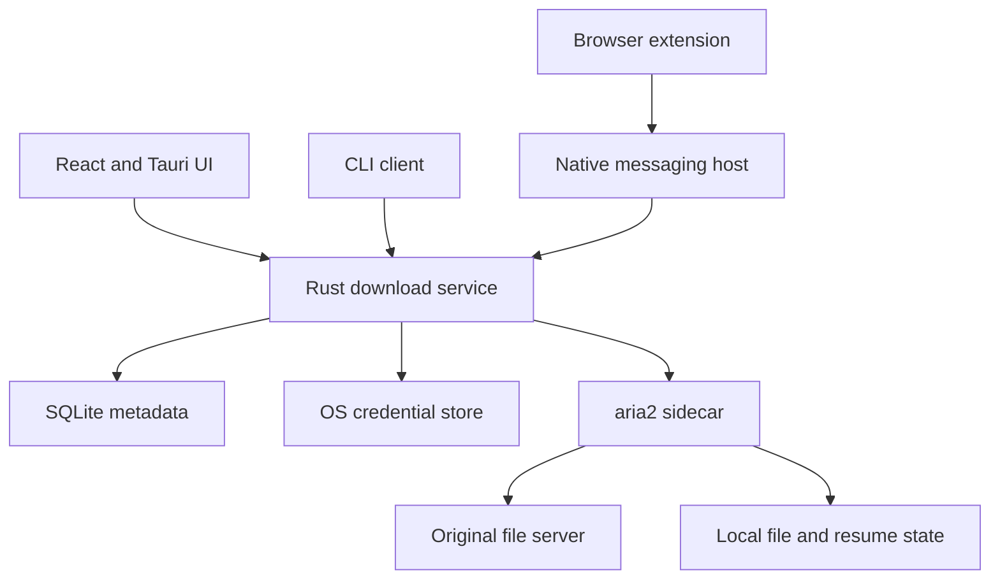

# বিনামূল্যের Cross-platform Download Manager — R&D ও Development Blueprint

প্রস্তুতের তারিখ: ১৭ অক্টোবর ২০২৬  
হালনাগাদ: attached Pasted text(1).txt-এর সম্পূর্ণ inventory মিলিয়ে Sections ১৬–১৯ যোগ করা হয়েছে; ১২টি advanced workflow, implementation contracts, backlog ও acceptance criteria অন্তর্ভুক্ত। Windows, macOS, Linux ও browser extension প্রথম অগ্রাধিকার।  
ভাষা: বাংলা; প্রয়োজনীয় প্রযুক্তিগত শব্দ ইংরেজিতে রাখা হয়েছে।  
অবস্থা: official documentation ও project repository ভিত্তিক feasibility research। কোনো prototype, speed benchmark বা release তৈরি করা হয়নি। নিচের সময়, performance লক্ষ্য ও architecture হলো প্রস্তাব; পরীক্ষিত ফলাফল নয়।

## ১. সুপারিশ

প্রথম সংস্করণ Windows, macOS ও Linux-এর জন্য তৈরি করো। তোমার React/TypeScript অভিজ্ঞতা ব্যবহার করার জন্য **React + Vite + TypeScript + Tauri 2** উপযোগী। UI থেকে আলাদা per-user Rust download service-এর মাধ্যমে **aria2** download engine চালাও। প্রথমে ছোট CLI harness দিয়ে engine ও recovery পরীক্ষা করো, তারপর desktop UI যুক্ত করো। History ও settings স্থানীয় SQLite database-এ থাকবে। Browser extension হবে আলাদা package।

প্রথম দিন থেকে নতুন segmented download engine লেখা প্রয়োজন নেই। প্রথমে প্রতিষ্ঠিত engine দিয়ে ব্যবহারযোগ্য app তৈরি করে recovery, browser integration ও resource usage যাচাই করো। নিজের Rust engine বানাবে তখনই, যখন benchmark বা প্রয়োজনীয় correctness test দেখাবে যে বিদ্যমান engine-এ নির্দিষ্ট সীমাবদ্ধতা আছে।

Android ও iOS পরবর্তী roadmap-এ থাকবে; বর্তমান প্রথম release-এর অগ্রাধিকার Windows, macOS, Linux ও desktop browser extension। Mobile-এর background download-এর জন্য platform-specific implementation লাগবে। Android-এর জন্য Kotlin adapter এবং iOS-এর জন্য Swift/URLSession adapter প্রয়োজন হবে। Tauri-এর mobile UI support-এর সঙ্গে OS-specific background কাজও বাস্তবায়ন করতে হবে। [S06, S11, S12]

প্রস্তাবিত অবস্থান: **সহজ, বিনামূল্যের, account ছাড়াই ব্যবহারযোগ্য download manager—বিশেষ করে বড় ফাইল ও অনির্ভরযোগ্য ইন্টারনেটের জন্য।**

## ২. বাজারে এখন কী আছে

| Product | Officially উল্লেখ করা platform | যাচাই করা capability | প্রকল্পের জন্য শিক্ষা |
|---|---|---|---|
| IDM | Windows; official FAQ-তে macOS/Linux/mobile সমর্থন নেই | Dynamic segmentation, browser integration, resume, scheduler; ৩০ দিনের trial-এর পরে paid | Windows-এর বাইরে ব্যবহারযোগ্যতা ও স্থায়ী free access দিয়ে সুবিধা দেওয়া সম্ভব। [S01–S03] |
| Free Download Manager | Windows, macOS, Linux, Android | Free, ad-free, segmented download, resume, browser integration, scheduler | Free ও cross-platform হওয়া একাই বাজারে আলাদা হওয়ার জন্য যথেষ্ট নয়। [S04] |
| AB Download Manager | Windows, macOS, Linux, Android | Free/open source, queues, scheduling, browser extension; repository-তে Apache-2.0 license | বিদ্যমান open-source app fork করার feasibility-ও বিবেচনা করা উচিত। [S05] |
| Gopeed | Windows, macOS, Linux-সহ আরও platform | Go + Flutter; browser extension, CLI/API; GPLv3 repository | Free ও cross-platform প্রতিযোগিতা ইতিমধ্যে শক্তিশালী; ব্যবহারের সুবিধা ও recovery দিয়ে পার্থক্য করতে হবে। [S27] |
| Neat Download Manager | Windows, macOS | Free; dynamic segmentation ও browser extension | ছোট app ও পরিচ্ছন্ন workflow-এর সঙ্গে তুলনা দরকার। [S28] |
| Motrix | Windows, macOS, Linux packages | Open-source desktop download manager; repository-তে aria2/Electron stack ও MIT project license উল্লেখ আছে | Engine reuse-এর বাস্তব উদাহরণ; bundled dependency-এর license আলাদাভাবে দেখতে হবে। [S18] |

এই তথ্য দিয়ে কোনো product অন্যটির চেয়ে দ্রুত বা বেশি reliable প্রমাণ হয় না। এখানে vendor-এর speed multiplier-কে benchmark ফলাফল হিসেবে ব্যবহার করা হয়নি।

## ৩. “সব operating system” বলতে বাস্তব scope

একটি codebase-এর অংশ ভাগ করা সম্ভব; প্রত্যেক OS ও CPU architecture-এর জন্য আলাদা build, installer এবং পরীক্ষা লাগবে। পুরোনো OS ও প্রত্যেক Linux distribution-এর compatibility স্বয়ংক্রিয়ভাবে নিশ্চিত করা যাবে না।

| ধাপ | প্রস্তাবিত target | বাস্তব deliverable | সীমাবদ্ধতা/যাচাই |
|---|---|---|---|
| Desktop MVP | Windows 10/11 x64 | EXE installer; পরে MSI/portable build | OS trust, code signing, native host registration |
| Desktop MVP | macOS 13+; Apple Silicon ও Intel | পৃথক বা universal DMG build | Mac build/test environment, signing ও notarization |
| Desktop MVP | Ubuntu 22.04/24.04 x64 | DEB ও AppImage | WebKitGTK/system dependency ও tray integration পরীক্ষা |
| পরে | অন্যান্য Linux distribution ও ARM64 | পরীক্ষিত package matrix অনুযায়ী | “Linux support” মানেই সব distro-তে একই ফল নয় |
| Mobile phase | Android; minimum version spike-এর পরে নির্ধারণ | APK/AAB ও native transfer adapter | Background execution, notification, battery ও storage আচরণ |
| Mobile phase | iOS/iPadOS; minimum version spike-এর পরে নির্ধারণ | Native background transfer-সহ app | Desktop-এর browser interception ও segmentation parity প্রতিশ্রুতি দেওয়া যাবে না |

Tauri desktop ও mobile frontend/backend integration সমর্থন করে; deployment format ও dependency platform অনুযায়ী পরিবর্তিত হয়। উপরের version boundary আমাদের প্রস্তাবিত support policy, Tauri-এর সর্বনিম্ন requirement-এর দাবি নয়। [S06, S07]

**Android:** user-triggered বড় download-এর জন্য Android 14+ এ User-Initiated Data Transfer job পরীক্ষা করো। ছোট/deferrable কাজের জন্য WorkManager ব্যবহার করা যায়। পুরোনো version-এর fallback এবং OS stop-এর পরে recovery আলাদাভাবে যাচাই করতে হবে। [S11]

**iOS:** HTTP(S) background transfer-এর জন্য system-managed URLSession ব্যবহার করতে হবে। App suspended হলেও transfer চলতে পারে; ব্যবহারকারী force-quit করলে system background transfer বাতিল করে। তাই desktop Rust/aria2 process-কে অনবরত চালিয়ে একই আচরণ আশা করা যাবে না। [S12]

## ৪. কোন প্রযুক্তি নেবে

| অংশ | সুপারিশ | উদ্দেশ্য |
|---|---|---|
| Desktop UI | React + Vite + TypeScript | বিদ্যমান frontend দক্ষতা কাজে লাগানো; স্থানীয় app UI |
| Desktop shell | Tauri 2 | Window, tray, IPC, installer ও OS integration |
| Coordinator | UI-স্বাধীন Rust per-user service + async runtime | Job lifecycle, queue, scheduling, engine control ও validation |
| প্রথম engine | aria2 sidecar | Segmented HTTP(S), pause/resume, bandwidth control ও RPC |
| Local metadata | SQLite | Download list, settings, categories, schedule, migration |
| Browser integration | TypeScript WebExtension + native messaging host | Browser থেকে download job পাঠানো |
| Credentials | OS credential store | প্রয়োজনীয় secret সাধারণ history/log থেকে আলাদা রাখা |
| Release | Per-OS CI build + signed updater artifacts | Installable, যাচাইযোগ্য release তৈরি |

এখানে Rust coordinator ব্যবহারকারীর যন্ত্রেই চলবে। প্রথম release চালানোর জন্য Express server, MongoDB, Firebase বা cloud account প্রয়োজন নেই। File bytes React state বা তোমার server-এর মধ্যে দিয়ে যাবে না।

Tauri system webview ব্যবহার করে; Electron Chromium-এর process model ব্যবহার করে। এই architecture দেখে Tauri বেছে নেওয়া যুক্তিসঙ্গত, কিন্তু নির্দিষ্ট RAM বা download speed advantage মেপে দেখাতে হবে। UI framework বাছাই করলেই download দ্রুত হয়ে যায় না। [S06, S17]

### বিকল্প পথ

| পথ | প্রধান লাভ | প্রধান খরচ | কখন বেছে নেবে |
|---|---|---|---|
| Tauri + React + aria2 | নিজের UI; প্রতিষ্ঠিত engine; web frontend reuse | Rust, sidecar packaging ও OS integration শিখতে হবে | এই প্রকল্পের জন্য প্রাথমিক সুপারিশ |
| Electron + React + aria2 | JavaScript/Node-কেন্দ্রিক workflow | Chromium/runtime overhead; mobile-এর জন্য আলাদা ব্যবস্থা | Rust শেখার সময় কম থাকলে |
| AB Download Manager fork | আগে থেকেই থাকা app, engine ও extension | Kotlin/Compose codebase শেখা; upstream maintenance ও license notices | সম্পূর্ণ app সবচেয়ে দ্রুত বাজারে আনা অগ্রাধিকার হলে |
| নিজস্ব Rust engine | Transfer logic পুরো নিয়ন্ত্রণে | Protocol correctness ও recovery-এর কাজ সবচেয়ে বেশি | পরীক্ষায় নির্দিষ্ট প্রয়োজন প্রমাণ হলে |

Fork করার আগে build reproducibility, engine coupling, outstanding issues ও extension architecture পরীক্ষা করতে হবে। শুধু repository-এর license দেখে extraction বা maintenance সহজ হবে ধরে নেওয়া যাবে না।

## ৫. Desktop architecture



প্রস্তাবিত দায়িত্ব:

- UI শুধু command পাঠাবে এবং progress দেখাবে; download engine-এর secret পাবে না। UI ও download service আলাদা process হবে; native host বা UI process exit-কে transfer service exit ধরা হবে না।
- Coordinator queue, policy, retry classification ও database lifecycle পরিচালনা করবে। প্রথম MVP-তে এটি একই OS user-এর process; elevated system service নয়। এক user-এর এক instance ও এক SQLite writer থাকবে।
- aria2 তার নিজস্ব transfer/control state-এর authority হবে। SQLite-এ আলাদা byte map লিখে দ্বিতীয় conflicting authority তৈরি করা হবে না।
- Native messaging host ছোট bridge হবে; browser বন্ধ হলে download engine যেন তার সঙ্গে বন্ধ না হয়।
- প্রথম release-এ window বন্ধ করলে tray-তে থাকা এবং download চালু রাখার স্পষ্ট setting থাকবে। “Exit and stop downloads” action service-কে checkpoint ও stop করতে বলবে; পরবর্তী launch-এ supported job resume হবে। UI crash-এর সময় service চালু রাখার আচরণ তিন OS-এ পরীক্ষা করতে হবে।
- Scheduler app চলমান থাকলে কাজ করবে। Login-এ app চালু করার option স্পষ্ট থাকবে; কম্পিউটার বন্ধ থাকলে নির্ধারিত সময়ে download শুরু হবে এমন প্রতিশ্রুতি থাকবে না।

UI/native bridge থেকে service-এর control path হবে Windows named pipe বা Unix-domain socket, user-only access এবং versioned message schema-সহ। aria2 RPC শুধু service-এর ভিতরের adapter ব্যবহার করবে; loopback binding ও random authorization secret থাকবে। Renderer বা browser webpage থেকে সরাসরি engine RPC access দেওয়া হবে না। এই IPC layout প্রস্তাবিত design; prototype-এ এখনও পরীক্ষা হয়নি। [S08]

## ৬. প্রথম সংস্করণের feature scope

### দরকারি baseline

1. Link paste করে HTTP/HTTPS download।
2. Server সমর্থন করলে segmented download।
3. Pause/resume/cancel/retry এবং app restart-এর পরে recovery।
4. একাধিক queue, priority ও global/per-download speed limit।
5. Folder/category rules, filename conflict ও duplicate URL handling।
6. Scheduler এবং download শেষে notification।
7. Chrome/Edge-এ “Download with…” action; পরে Firefox।
8. History, search, clear error message ও diagnostic export।
9. ইংরেজি/বাংলা UI, keyboard access, readable progress ও light/dark theme।
10. Signed updater এবং install/uninstall-এর পরিষ্কার আচরণ।

Resume, scheduler ও segmentation IDM-এও আছে। এগুলো নতুন সুবিধা হিসেবে প্রচার না করে প্রয়োজনীয় baseline হিসেবে তৈরি করতে হবে। [S02]

### যে জায়গাগুলোতে ব্যবহারকারীর জন্য বাড়তি মূল্য দিতে পারো

| প্রস্তাব | বাস্তব অভিজ্ঞতা | প্রমাণ করার উপায় |
|---|---|---|
| দুর্বল নেটওয়ার্কে recovery | Wi-Fi বিচ্ছিন্ন হলে reconnect-এর পরে supported transfer চালু | Fault-injection test ও completed file hash |
| Download problem diagnosis | “Link expired”, “server resume দেয় না”, “disk full”—আলাদা ব্যাখ্যা | Fixture-এ সঠিক error classification |
| Link replacement workflow | পুরোনো link-এর বদলে নতুন link নিয়ে নিরাপদে পুনরায় চেষ্টা | একই file version যাচাই; না মিললে restart/stop |
| Adaptive connection policy | বেশি connection দিয়ে সব site-এ চাপ না দিয়ে উপযুক্ত profile | ১/২/৪/৮ connection experiment |
| হালকা ও পরিষ্কার UI | সহজ queue ও কম background work | পুরো process tree-এর memory/CPU measurement |
| বিশ্বাসযোগ্য free distribution | Account ছাড়া local ব্যবহার; ads ও tracking ছাড়াই core feature | Public source, documented release ও privacy behavior |

এই বৈশিষ্ট্যগুলোর কয়েকটি অন্য app-এও আছে। লক্ষ্য হবে নির্বাচিত user group-এর জন্য ভালো execution; প্রতিটিকে বাজারে সম্পূর্ণ নতুন আবিষ্কার বলা যাবে না।

## ৭. Download correctness: সবচেয়ে গুরুত্বপূর্ণ engineering কাজ

HTTP server Range request উপেক্ষা করতে পারে। শুধু Accept-Ranges দেখে resume নিরাপদ ধরে নেওয়া যাবে না। বাস্তব response-এর 206/Content-Range যাচাই এবং file version-এর জন্য ETag/If-Range বা উপযুক্ত validator বিবেচনা করতে হবে। Range-এর উত্তরে 200, invalid range-এ 416, অথবা remote file বদলে গেলে পুরোনো ও নতুন bytes মিশিয়ে দেওয়া চলবে না। [S09]

প্রস্তাবিত recovery policy:

- Transfer শুরুতে ও resume-এর সময় remote identity ও engine-এর আচরণ যাচাই।
- নির্ভরযোগ্য validator না থাকলে একই length-কে একই file-এর প্রমাণ ধরা যাবে না; নিরাপদ restart অথবা ব্যবহারকারীর সিদ্ধান্ত প্রয়োজন হতে পারে।
- Signed URL বদলানোর পরে একই resource যাচাই ছাড়া পুরোনো bytes reuse করা যাবে না।
- 429/503-এর retry policy-তে server নির্দেশ ও backoff থাকবে; authentication failure-এ blind retry নয়।
- Disk full হলে job থামবে এবং partial data রাখা হবে; অন্য file overwrite করবে না।
- Completion-এর আগে expected length এবং trusted checksum পাওয়া গেলে checksum যাচাই হবে। নিজের তৈরি hash একা publisher authenticity প্রমাণ করে না।
- Crash-এর পরে engine control file/session এবং application job list reconcile হবে। Completion, verification ও final filename change আলাদা state হবে।
- File rename collision, unavailable folder ও externally deleted partial file-এর নির্দিষ্ট আচরণ থাকবে।

**aria2 নির্বাচনের শর্ত:** ETag বদলানো, Range ignore, truncated response, expired URL ও crash recovery fixture-এ safe behavior দেখাতে হবে। Wrapper থেকে প্রয়োজনীয় validation সম্ভব না হলে engine patch, অন্য engine বা সীমিত custom transport বেছে নিতে হবে। এটি এখনো যাচাই করা হয়নি।

আরও connection মানেই আরও speed নয়। Server limit, network capacity, packet loss ও disk throughput-এর ওপর ফল নির্ভর করবে। শুরুতে conservative profile রাখো; controlled test দিয়ে policy নির্ধারণ করো। ১০০ Mbps সংযোগের তাত্ত্বিক rate প্রায় ১২.৫ MB/s; application সেই bandwidth সীমা অতিক্রম করাতে পারবে না।

## ৮. Browser integration-এর বাস্তব scope

প্রথমে public GET link-এর explicit context-menu action তৈরি করো। এরপর optional automatic handoff যোগ করো। Chrome-এর native messaging দিয়ে extension ও local native app যোগাযোগ করতে পারে; downloads API download event ও control-এর জন্য ব্যবহার করা যায়। Firefox-এর জন্য পৃথক manifest/compatibility validation প্রয়োজন। [S10]

Manifest V3-এ অধিকাংশ extension-এর জন্য webRequestBlocking নেই, যদিও observational webRequest আছে। তাই পুরোনো blocking interception design হুবহু ব্যবহার করা যাবে না। [S19]

পরীক্ষার scope:

- App installed/uninstalled, host missing এবং app start failure।
- Duplicate download এড়াতে browser/native handoff acknowledgement।
- Redirect, Content-Disposition filename এবং unknown file size।
- Login-required download-এর জন্য প্রয়োজনীয় domain-scoped context; cookie access আলাদা permission ও ব্যবহারকারীর স্পষ্ট action অনুযায়ী।
- POST-generated file, blob URL এবং browser-only temporary content আলাদা compatibility category; প্রথম release-এ সর্বজনীন support দাবি নয়।
- Browser বন্ধ হলেও native job চালু থাকা।
- Safari extension এবং mobile share-sheet আলাদা পরবর্তী কাজ; desktop Chrome extension সব platform-এ চলবে ধরে নেওয়া যাবে না।

## ৯. Media download পরে যোগ করো

Direct downloadable media প্রথম HTTP(S) scope-এ আসতে পারে। HLS/DASH ও site-specific extraction আলাদা feature phase হবে। Audio/video merge-এর জন্য FFmpeg এবং প্রয়োজন হলে yt-dlp evaluate করা যায়। এগুলো ordinary file resume থেকে আলাদা pipeline। [S15, S16]

Media support-এর সঙ্গে extractor maintenance, URL expiry, subtitles, separate audio/video ও অতিরিক্ত binary size যুক্ত হবে। DRM bypass প্রকল্পের scope হবে না। “সব website-এর video” প্রতিশ্রুতি দেওয়া বাস্তবসম্মত নয়।

yt-dlp source-এর license ও packaged executable-এর license এক নাও হতে পারে; FFmpeg-এর license build configuration অনুযায়ী বদলায়। Optional media module-এর binary, source ও license inventory আলাদা থাকবে। [S15, S16]

## ১০. বিনামূল্যে চালানোর অর্থনীতি ও release

### Download-এর জন্য central server দরকার নেই

সরাসরি original host থেকে ব্যবহারকারীর device-এ file যাবে। তাই ব্যবহারকারীর প্রতিটি download-এর bandwidth তোমাকে বহন করতে হবে না। App কাজ করার জন্য paid cloud subscription বা login বাধ্যতামূলক হবে না।

Project খরচ থাকবে development, device testing, installer distribution, signing, website এবং maintenance-এ। Release distribution-এর জন্য GitHub Releases ব্যবহার করা যায়; public repository-তে standard GitHub-hosted Actions runner-এর usage বর্তমানে free। অন্য runner, storage ও service-এর বর্তমান terms মানতে হবে। [S14]

Apple Developer Program-এর প্রকাশিত fee বর্তমানে USD 99/year। macOS Developer ID signing/notarization এবং iOS distribution পরিকল্পনায় এটি ধরতে হবে। Windows certificate, store registration, domain এবং test hardware-এর খরচ আলাদা; যাচাই ছাড়া কোনো fixed মূল্য ধরা হয়নি। [S13]

Funding proposal: voluntary donations, transparent sponsorship ও paid support। Core downloading/resume/queue feature free থাকবে। Cloud sync বা hosted remote-control ভবিষ্যতে হলে তার server cost আলাদা business decision হবে।

### Free মানে license শর্তহীন নয়

aria2 GPL-2.0-or-later। Bundled binary-এর সঙ্গে সংশ্লিষ্ট license notices ও exact corresponding source-এর ব্যবস্থা প্রয়োজন। নিজের UI-তে MIT/Apache লিখলেই bundled engine-এর license বদলায় না। পুরো application-এর license distribution model ও dependency audit-এর পরে স্থির করতে হবে। [S20]

Release-এ dependency versions pin, third-party notices, source/build instructions এবং signed update artifacts থাকবে। Tauri updater update signature যাচাই সমর্থন করে; updater signing key ও OS publisher certificate আলাদা বিষয়। [S21]

Download URL-এর query token, cookie ও authorization header diagnostic log-এ থাকবে না। Installed app downloaded executable নিজে থেকে চালাবে না। এগুলো download manager-এর সরাসরি product requirements।

## ১১. IDM-এর চেয়ে ভালো হয়েছে কীভাবে মাপবে

এই গবেষণায় benchmark চালানো হয়নি। প্রকাশের আগে নিচের পরীক্ষাগুলো চালাতে হবে।

**Windows baseline:** browser built-in downloader, IDM, FDM, AB Download Manager, aria2 standalone এবং নিজের app। macOS/Linux-এ nativeভাবে উপলব্ধ baseline ব্যবহার করবে; IDM-এর Windows result-এর সঙ্গে অন্য OS-এর সরাসরি speed ranking করবে না।

| পরিস্থিতি | পরিবর্তন/fixture | কী মাপবে |
|---|---|---|
| সাধারণ file transfer | 100 MiB, 1 GiB; LAN ও controlled remote host | End-to-end completion, CPU, memory, disk I/O |
| Connection tuning | ১/২/৪/৮ connection; unrestricted ও per-connection cap | কোন profile-এ লাভ/ক্ষতি |
| Unstable network | Disconnect, latency, packet loss, Wi-Fi switch | Recovery time, পুনরায় download হওয়া bytes |
| Protocol fallback | Range ignored, malformed range, unknown size | Safe fallback; corrupt success নয় |
| Changed/expired file | Same-length changed content, changed ETag, expired signed URL | Safe stop/restart এবং সঠিক message |
| Crash/lifecycle | App kill, restart, tray close, browser close | State recovery ও orphan process |
| Disk behavior | Low space, permission denied, rename collision | Existing file রক্ষা ও recoverable failure |
| Browser cases | Public GET, redirect, authenticated link, POST/blob | প্রতিটি category-র compatibility |

একই device, server, network profile ও comparable connection policy ব্যবহার করতে হবে। App-গুলো একসঙ্গে চালিয়ে bandwidth ভাগ করে speed comparison করবে না। Test order ঘুরিয়ে অন্তত ৫ বার চালিয়ে median দেখাবে; p95 প্রকাশ করলে পর্যাপ্ত sample, যেমন অন্তত ২০ run, নেবে।

Memory report-এ UI, webview, coordinator ও engine—পুরো process tree ধরা হবে। Cached download বা verification/merge বাদ দিয়ে misleading speed দেখানো যাবে না। Benchmark scripts, app versions ও raw result প্রকাশ করবে।

প্রস্তাবিত release gates:

- Controlled integrity fixture-এ প্রত্যেক completed result expected hash-এর সঙ্গে মেলে; silent corruption পেলে release block।
- Network interruption ও process-kill recovery বারবার চালিয়ে ফল সংরক্ষণ।
- MVP-এর public GET browser handoff সব target desktop OS-এ কাজ করে।
- Windows baseline-এর তুলনায় material regression ব্যাখ্যা/সমাধান করা হয়েছে; speed superiority কেবল পুনরুৎপাদনযোগ্য ফল থাকলে দাবি।
- Install, uninstall, update ও missing native host-এর failure path পরীক্ষা করা হয়েছে।
- বাংলা/ইংরেজি UI-তে failed, paused, cancelled এবং completed status স্পষ্ট।

## ১২. Development roadmap

সময়গুলো engineering estimate; এক জন full-time developer, engine reuse ও desktop MVP scope ধরা হয়েছে। Rust/desktop development নতুন হলে অতিরিক্ত সময় লাগবে। কাজের সময়, test device ও browser compatibility spike ছাড়া commitment দেওয়া উচিত নয়।

| সময় | কাজ | দৃশ্যমান deliverable |
|---|---|---|
| সপ্তাহ ১–২ | UI-স্বাধীন Rust service + aria2 + ছোট CLI harness; Tauri spike; AB/Gopeed reuse feasibility; protocol fixtures; Chrome native bridge | তিন desktop OS-এ add/pause/resume ও minimal packaging; go/no-go decision |
| সপ্তাহ ৩–৫ | Job state, queue, SQLite, partial-file recovery | ব্যবহারযোগ্য download list ও restart recovery |
| সপ্তাহ ৬–৮ | Chrome/Edge handoff, rules, settings, speed control | Browser থেকে normal link download |
| সপ্তাহ ৯–১২ | Scheduling, diagnostics, localisation, per-OS installer | সীমিত desktop beta |
| সপ্তাহ ১৩–১৬ | Fault tests, benchmark, update/signing ও beta fixes | Release candidate; documented limitations |
| Desktop beta-এর পরে | Android background/storage adapter ও lifecycle tests | আলাদা Android beta; প্রাথমিক estimate আরও ৬–১০ সপ্তাহ |
| আলাদা feasibility decision | Swift URLSession, share sheet, sandbox ও iOS lifecycle | iOS feasibility result; beta-এর প্রাথমিক estimate আরও ৬–১০+ সপ্তাহ |

১০–১৬ সপ্তাহে desktop MVP সম্ভব হতে পারে, কিন্তু নতুন framework শেখা ও broad authenticated/media compatibility এই estimate বাড়াতে পারে। সব OS-এ IDM-এর সমান mature product তৈরিকে কয়েক সপ্তাহের কাজ ধরা যাবে না।

### প্রথম দুই সপ্তাহের সিদ্ধান্তের নিয়ম

1. aria2 দিয়ে correctness fixture ও crash recovery safe হলে desktop architecture এগিয়ে নাও।
2. প্রয়োজনীয় behavior wrapper থেকে সম্ভব না হলে cost estimate-সহ patch/engine বিকল্প পরীক্ষা করো।
3. Engine তৈরিতে বড় সময় গেলে AB fork পথের maintenance ও feature feasibility-এর সঙ্গে তুলনা করো।
4. তিন OS-এর app package এবং এক browser-এর end-to-end handoff না পাওয়া পর্যন্ত media/mobile feature শুরু করো না।

## ১৩. Official sources

সব source এই R&D-র সময় দেখা হয়েছে। Feature page-এর ঘোষণা স্বাধীন benchmark নয়। Proposed design ও সময়ের হিসাব লেখকের engineering assessment।

- **S01 — IDM platform support:** [Official FAQ](https://www.internetdownloadmanager.com/register/new_faq/functions1.html)
- **S02 — IDM baseline features:** [Features](https://www.internetdownloadmanager.com/features2.html), [Dynamic segmentation](https://www.internetdownloadmanager.com/support/segmentation.html)
- **S03 — IDM pricing model:** [Trial expiry FAQ](https://internetdownloadmanager.com/register/new_faq/register4.html)
- **S04 — FDM:** [Features](https://www.freedownloadmanager.org/features.htm), [Platform downloads](https://www.freedownloadmanager.org/download.htm)
- **S05 — AB Download Manager:** [Repository](https://github.com/amir1376/ab-download-manager), [License](https://github.com/amir1376/ab-download-manager/blob/master/LICENSE)
- **S06 — Tauri:** [What is Tauri?](https://v2.tauri.app/start/), [Architecture](https://v2.tauri.app/concept/architecture/)
- **S07 — Tauri distribution:** [Distribution guide](https://v2.tauri.app/distribute/), [Prerequisites](https://v2.tauri.app/start/prerequisites/)
- **S08 — aria2 engine and RPC:** [Official manual](https://aria2.github.io/manual/en/html/aria2c.html)
- **S09 — HTTP semantics:** [RFC 9110: Range, validators, Content-Range](https://www.rfc-editor.org/rfc/rfc9110.html)
- **S10 — Browser bridge:** [Chrome native messaging](https://developer.chrome.com/docs/extensions/develop/concepts/native-messaging), [Chrome downloads API](https://developer.chrome.com/docs/extensions/reference/api/downloads), [Firefox connectNative](https://developer.mozilla.org/en-US/docs/Mozilla/Add-ons/WebExtensions/API/runtime/connectNative)
- **S11 — Android:** [UIDT jobs](https://developer.android.com/develop/background-work/background-tasks/uidt), [Data transfer background options](https://developer.android.com/develop/background-work/background-tasks/data-transfer-options)
- **S12 — Apple background transfers:** [Downloading in the background](https://developer.apple.com/documentation/foundation/downloading-files-in-the-background), [Background configuration and force-quit behavior](https://developer.apple.com/documentation/foundation/urlsessionconfiguration/background(withidentifier:))
- **S13 — Apple release costs:** [Developer Program](https://developer.apple.com/programs), [Developer ID](https://developer.apple.com/developer-id/)
- **S14 — GitHub distribution:** [About releases](https://docs.github.com/en/repositories/releasing-projects-on-github/about-releases), [Actions billing](https://docs.github.com/en/billing/concepts/product-billing/github-actions)
- **S15 — yt-dlp:** [Official repository and licensing notes](https://github.com/yt-dlp/yt-dlp)
- **S16 — FFmpeg:** [License/build considerations](https://www.ffmpeg.org/legal.html)
- **S17 — Electron:** [Official process model](https://www.electronjs.org/docs/latest/tutorial/process-model)
- **S18 — Motrix:** [Official repository](https://github.com/agalwood/Motrix)
- **S19 — Manifest V3:** [Chrome webRequest API](https://developer.chrome.com/docs/extensions/reference/webRequest)
- **S20 — GPL distribution:** [aria2 license declaration](https://aria2.github.io/), [GNU GPL distribution FAQ](https://www.gnu.org/licenses/gpl-faq.en.html)
- **S21 — Updates:** [Tauri updater](https://v2.tauri.app/plugin/updater/)

## ১৪. প্রথম তুলনায় শনাক্ত features ও তাদের অন্তর্ভুক্তি

সংযোজনের তারিখ: ১৭ অক্টোবর ২০২৬। তুলনার ভিত্তি: তোমার দেওয়া **Pasted text(6).txt**, “Building a download accelerator in the class of IDM”, এবং এই নথির Sections ১–১৩। নিচের তালিকা product requirements ও পরিকল্পনা; এগুলো implement বা benchmark করা হয়নি।

Sections ১–১৩-এর প্রথম সংস্করণের তুলনায় **১৬টি feature gap** এবং **৬টি feature-এর অতিরিক্ত detail** পাওয়া গিয়েছিল। Section ১৪ থেকে এগুলো requirements-এ অন্তর্ভুক্ত হয়েছে; বর্তমান পূর্ণ রিপোর্টে এগুলো আর অনুপস্থিত item নয়। কোনো engine-এর ভেতরে capability থাকা আর আমাদের app-এ ব্যবহারকারীর জন্য সেটি expose করা এক বিষয় নয়। তাই aria2-এর CLI/RPC থাকলেও আগের product scope-এ public CLI/API না থাকাকে gap হিসেবে ধরা হয়েছে।

### ১৪.১ বাদ পড়া ১৬টি feature ও প্রস্তাবিত phase

Phase-এর অর্থ: **MVP+** = ভিত্তিগত desktop MVP-এর পরের ছোট increment; **V1** = পূর্ণ desktop release-এর সম্প্রসারণ; **V2** = বড় optional module। Dependency বা OS test fail করলে feature-এর phase বদলাতে হবে।

| ID | বাদ পড়া feature | কী যোগ হবে | Phase |
|---|---|---|---|
| F01 | ব্যবহারকারীর CLI ও documented local API | `add`, `list`, `pause`, `resume`, `cancel`; versioned request/event format। প্রথম sprint-এ internal CLI harness ও UI-স্বাধীন service থাকবে; public scripting docs ও server-style packaging পরে | Public CLI: MVP+; headless packaging: V1 |
| F02 | Clipboard monitor | ব্যবহারকারী চালু করলে নতুন copied URL শনাক্ত করে Add Download prompt; duplicate suppression ও ignore rules | MVP+ |
| F03 | Drag-and-drop ও floating drop target | App window-তে link drop; optional ছোট floating target; completed file drag-out-এর OS-specific feasibility | MVP+; floating: V1 |
| F04 | Bulk links ও file import | “Download selected/all links” preview; filter ও deduplicate; TXT থেকে URL import এবং batch queue | MVP+ |
| F05 | FTP ও SFTP | HTTP(S)-এর বাইরে protocol-specific login, connection, retry ও resume test; SFTP host-key যাচাই | V1 |
| F06 | Proxy profile ও enterprise authentication | Manual HTTP proxy, bypass list ও credentials; SOCKS5/PAC/system proxy এবং Digest/NTLM/Kerberos আলাদা capability test-এর পরে | Basic proxy: MVP+; advanced: V1/V2 |
| F07 | Antivirus integration ও origin marking | Windows Attachment Services/MOTW public beta-এর আগে; scan pending/blocked/skipped status; অন্য OS-এ supported installed-scanner integration evaluate | Windows: beta gate; অন্য OS: পরবর্তী পরীক্ষা |
| F08 | Download শেষে shutdown/sleep | নির্বাচিত queue শেষ হলে user-selected action; countdown ও cancel; active job বা failed verification থাকলে action স্থগিত | V1 |
| F09 | Website/site grabber ও spider | Domain/depth/file-type সীমাসহ crawler; preview, deduplication; static resource-এর offline link rewriting | V2 |
| F10 | Periodic file sync | নির্ধারিত interval-এ remote file পরিবর্তন পরীক্ষা; বদলালে নতুন version download; conflict/version policy | V2 |
| F11 | BitTorrent ও magnet links | `.torrent`/magnet add, file selection, peer progress ও upload/seeding controls | V2 |
| F12 | Metalink ও verified mirror download | `.metalink`/`.meta4`, alternate mirrors, trusted whole-file/chunk hash verification | V2 |
| F13 | Mobile companion/remote control | Paired phone থেকে PC-তে job পাঠানো, status দেখা, pause/resume; standalone mobile downloader থেকে আলাদা feature | V2 |
| F14 | Devices-এর মধ্যে queue/history sync | Optional metadata export/import বা encrypted sync; file bytes transfer ও credential sync আলাদা scope | V2 |
| F15 | অতিরিক্ত ভাষা ও RTL support | বাংলা/ইংরেজির পরে Arabic-সহ RTL layout, plural/date/number formatting ও layout QA | i18n foundation: V1; languages: ধাপে |
| F16 | Custom themes/skins | Light/dark-এর বাইরে colour tokens ও high-contrast theme; পরে সীমিত theme customisation | V1/V2 |

FTP/SFTP, BitTorrent ও Metalink aria2-এর documented capability-এর মধ্যে আছে; আমাদের binary build, app UI ও failure behavior পরীক্ষা করে product support ঘোষণা করতে হবে। Basic proxy support থেকে advanced proxy/authentication support স্বয়ংক্রিয়ভাবে ধরে নেওয়া যাবে না। [S08, S26]

### ১৪.২ আগে আংশিক ছিল—আরও যে ৬টি detail যোগ হলো

| ID | আগে থাকা অংশ | বাড়তি requirement |
|---|---|---|
| E01 | HLS/DASH ও FFmpeg-এর উল্লেখ | Format/quality picker, audio-only choice, separate audio/video merge, available subtitle selection এবং media-specific progress/error |
| E02 | Chrome/Edge, পরে Firefox | Opera compatibility track; MIME/extension/size filters, site exclusion এবং প্রয়োজনীয় domain-scoped referrer/user-agent/session handling |
| E03 | Segmented download ও connection tuning | সব job মিলিয়ে per-host connection budget; ছোট range-এ অতিরিক্ত split বন্ধ; dynamic scheduling আলাদা experiment; HTTP/2/3 transport-এর পৃথক feasibility |
| E04 | Crash recovery ও disk error handling | Partial-file allocation policy, data/state durability ordering, filesystem size limits, Unicode/`filename*`, invalid path এবং filename normalisation test |
| E05 | Diagnostic export | Opt-in crash report-এর local preview; URL token/cookie/header redaction; offline export; analytics-এর জন্য feature gating নয় |
| E06 | Verification/completion lifecycle | প্রয়োজন হলে `scanning`, `blocked`, `scan-unavailable` state; UI ও CLI থেকে একই status; scan failure-কে verified safe হিসেবে দেখানো নয় |

HLS segment encrypted হওয়া আর DRM-protected হওয়া এক অর্থ নয়। Media module-এর supported manifest/key mode স্পষ্ট করতে হবে; DRM-protected content এই পরিকল্পনার scope-এর বাইরে থাকবে। Codec conversion এবং lossless muxing-ও আলাদা operation হিসেবে দেখাতে হবে।

### ১৪.৩ নতুন feature-এর কাজের নিয়ম ও acceptance criteria

**CLI/API ও headless operation:** API loopback/local IPC-তেই থাকবে; authentication, input validation ও version negotiation থাকবে। UI আর CLI থেকে একই job add করলে duplicate বা conflicting state তৈরি হবে না। HTTP download-এর মতো বড় payload native messaging-এ পাঠানো হবে না। UI-স্বাধীন service শুরু থেকেই থাকবে; user-facing headless packaging যোগ হলে app Quit, stop-service ও reboot-এর আচরণ আলাদা করে document করতে হবে।

**Clipboard, drag-and-drop ও batch import:** clipboard monitoring opt-in হবে; copy করলেই download শুরু হবে না। Floating widget hide করা যাবে। Bulk links আগে filename/domain/count preview দেখাবে। একই batch-এ invalid URL থাকলে অন্য valid item-এর ফল হারাবে না। Unsupported drop operation হলে paste/import বিকল্প থাকবে।

**Proxy ও authentication:** প্রতিটি profile-এর supported protocol প্রকাশ করা হবে। aria2-এর documented HTTP proxy-কে SOCKS5 বা PAC support বলে দেখানো যাবে না। Advanced feature-এর জন্য adapter/অন্য client দরকার হলে decision spike হবে। Proxy password সাধারণ SQLite history, command output বা exported log-এ থাকবে না। Unsupported profile-এ silent direct connection করা হবে না। [S08, S26]

**Antivirus ও MOTW:** Windows-এ file-এর source context রেখে Attachment Services integration পরীক্ষা করতে হবে। `IAttachmentExecute::Save` scanner/trust service চালাতে পারে এবং file পরিবর্তন বা মুছতে পারে; তাই scan-এর পরে file ও result পুনরায় যাচাই করতে হবে। MOTW থাকা malware-free হওয়ার প্রমাণ নয়। অন্য OS-এ scanner না থাকলে “scan unavailable” দেখাবে। [S22]

**Post-download action:** shutdown/sleep প্রতিবার ব্যবহারকারীর নির্বাচিত setting হবে। শুরু করার আগে countdown ও Cancel থাকবে। Queue-এর file download হলেও verification/scanning চললে action হবে না। OS permission বা feature অনুপস্থিত হলে action unavailable দেখাবে।

**Site grabber ও periodic sync:** crawler-এর domain, depth, file count, total bytes এবং concurrency limit থাকবে। প্রথমে static page/resource scope; পুরো dynamic website অফলাইনে একইভাবে চলবে এমন দাবি নয়। Periodic sync local edit overwrite বা file delete করার আগে version/conflict policy অনুসরণ করবে। এগুলো website cloning service বা bidirectional cloud drive নয়।

**Torrent ও Metalink:** transport-এর ধরন UI-তে স্পষ্ট হবে। Torrent-এর upload/seeding ও bandwidth controls download শুরু হওয়ার আগেই দৃশ্যমান থাকবে। Mirror বদলানোর সময় same size-কে same file-এর প্রমাণ ধরা যাবে না; trusted content hash বা equivalent verification প্রয়োজন। অন্য server-এর ETag একই content-এর global identity হিসেবে ব্যবহার করা যাবে না। [S08, S09]

**Mobile companion ও sync:** প্রথমে local-network pairing evaluate করা হবে। Internet-facing unauthenticated RPC নয়। PC চালু, app running ও reachable থাকার requirement দেখাবে। History/queue sync-এ expiring link এবং credential বাদ দেওয়ার default policy থাকবে। Hosted relay/sync চাইলে server cost ও maintenance-এর আলাদা অনুমান লাগবে; direct downloads local-ই থাকবে।

**RTL, filenames ও durability:** Arabic text-এও URL/path যথাযথ direction-এ দেখাতে হবে। Server-provided filename advisory; path separator, control character ও reserved name normalise করতে হবে। Segment position SQLite-এ লিখলেই downloaded file-এর bytes durable হয় না—data flush/checkpoint ordering এবং process/power-failure recovery পরীক্ষা প্রয়োজন। পুরোনো report-এর engine-owned state policy বজায় থাকবে। [S25]

### ১৪.৪ সংযুক্ত R&D থেকে নেওয়ার সময় প্রয়োজনীয় সংশোধন

| সংযুক্ত নথির বিষয় | সমন্বিত পরিকল্পনায় সঠিক ব্যাখ্যা |
|---|---|
| Browser download আগে `cancel/erase`, পরে native handoff | সম্ভব হলে আগে native app-এর গ্রহণ/প্রস্তুতি নিশ্চিত করতে হবে; native transfer প্রতিষ্ঠিত হওয়ার পর takeover। Host missing/unsupported request-এ browser download বজায় থাকবে। ইতিমধ্যে cancellation হলে arbitrary POST/auth request সব ক্ষেত্রে পুনরায় চালু করা যাবে ধরে নেওয়া যাবে না। |
| “GPL code pulls your whole product under GPL” | License ফল integration/combined-work ও distribution model-এর ওপর নির্ভরশীল; mere aggregation ও tightly integrated combined program এক নয়। Bundled GPL binary-এর source/notices obligation থাকবেই; closed UI স্বয়ংক্রিয়ভাবে অনুমোদিত বা নিষিদ্ধ কোনোটিই ধরে নেওয়া যাবে না। [S20] |
| Code signing/EV certificate দিলে SmartScreen ও সব AV warning চলে যাবে | Signing identity/integrity দেয়; নতুন signed binary-তেও reputation warning হতে পারে। Warning-free release-কে guaranteed acceptance criterion করা যাবে না। [S24] |
| aria2 ব্যবহার করলেই HTTP/2, SOCKS5/PAC ও সব enterprise auth পাওয়া যাবে | Official feature list HTTP/1.1, HTTP proxy ও Basic authentication উল্লেখ করে। অন্য capability আলাদা implementation ও test ছাড়া promise নয়। [S26] |
| `Content-Length` নেই মানেই কোনোভাবেই range করা যাবে না | Sequential fallback নিরাপদ default; তবে `Content-Range` থেকে total size/valid range জানা যেতে পারে। Header অনুপস্থিতি একা সর্বজনীন নিষেধ নয়। [S09] |
| প্রতি কয়েক MiB-তে position save মানেই corruption কখনো হবে না | Buffered file bytes ও committed metadata-এর crash consistency আলাদা। Durability policy এবং fault test ছাড়া এমন guarantee দেওয়া যাবে না। |
| সব encrypted stream মানেই DRM | Encryption mode ও DRM আলাদা করে classify করতে হবে; unsupported/protected content-এর স্পষ্ট status থাকবে। |
| Media helper desktop-এ রাখলেই extension store policy পূরণ | Chrome Web Store-এর policy পুরো user experience বিবেচনা করে; YouTube download facilitate করাও rejection-এর কারণ হতে পারে। Desktop split একা compliance প্রমাণ নয়। [S23] |
| Scheduling/media-কে paid tier-এ রাখা | তোমার free-use লক্ষ্য অনুযায়ী পরিকল্পিত স্থানীয় download, scheduler, browser integration ও media feature free থাকবে। Donation/sponsorship/support funding model ব্যবহার করা যাবে। |

আনুমানিক installer size, vendor speed multiplier বা attachment-এর regional price থেকে কোনো পরীক্ষিত ফল তৈরি করা হয়নি। Package-এর আকারে sidecar, webview dependency এবং optional media helper-এর প্রভাব মেপে দেখাতে হবে।

### ১৪.৫ অতিরিক্ত scope roadmap-এ কীভাবে বসবে

Sections ১২-এর **১০–১৬ সপ্তাহ** estimate ভিত্তিগত desktop MVP-এর জন্য। এই addendum-এর সব feature সেই estimate-এর মধ্যে ধরা হয়নি।

| পর্যায় | এই সংযোজন থেকে অন্তর্ভুক্ত scope | পরিকল্পনার শর্ত |
|---|---|---|
| MVP+ | CLI, opt-in clipboard prompt, drag/drop, bulk import, basic proxy | Recovery ও browser handoff stable হওয়ার পরে; ছোট independent increment |
| V1 সম্প্রসারণ | FTP/SFTP, advanced AV workflow, finish actions, media quality controls, Opera QA, RTL foundation | OS adapters, protocol fixtures ও installer lifecycle test |
| V2 modules | Site grabber, periodic sync, torrent/magnet, Metalink/mirrors, mobile companion, device sync ও advanced proxy/auth | আলাদা requirements, ownership ও effort estimate |

তোমার attached R&D-এর ২–৩ engineer/প্রায় ৩২ সপ্তাহের হিসাব একটি planning assumption। সেটিকে এক জন developer-এর engine-reuse MVP estimate-এর সঙ্গে সরাসরি তুলনা করা যাবে না। Scope, team experience, media compatibility এবং mobile testing স্থির করে expanded roadmap-এর সময় আলাদাভাবে নির্ধারণ করতে হবে।

### ১৪.৬ সংযোজনের official references

- **S22 — Windows downloaded-file handling:** [IAttachmentExecute::Save](https://learn.microsoft.com/en-us/windows/win32/api/shobjidl_core/nf-shobjidl_core-iattachmentexecute-save), [Attachment Manager/MOTW](https://support.microsoft.com/en-us/windows/security/information-about-the-attachment-manager-in-microsoft-windows)
- **S23 — Browser store behavior:** [Chrome Web Store violation troubleshooting](https://developer.chrome.com/docs/webstore/troubleshooting/), [Program policies](https://developer.chrome.com/docs/webstore/program-policies/policies?hl=en)
- **S24 — Signing versus reputation:** [Microsoft SmartScreen reputation for developers](https://learn.microsoft.com/en-us/windows/apps/package-and-deploy/smartscreen-reputation)
- **S25 — International filenames and path handling:** [RFC 6266](https://datatracker.ietf.org/doc/html/rfc6266)
- **S26 — aria2 protocol/authentication feature list:** [Official README documentation](https://aria2.github.io/manual/en/html/README.html)

আগের S08–S10, S15–S16 এবং S20 references-ও এই সংযোজনের প্রযোজ্য technical ভিত্তি। Feature phase ও acceptance criteria হলো এই প্রকল্পের জন্য প্রস্তাবিত design decision।

## ১৫. Desktop ও extension অগ্রাধিকার অনুযায়ী implementation decision

এই অংশ বর্তমান অনুরোধ অনুযায়ী architecture ও প্রথম release-এর সিদ্ধান্ত আরও নির্দিষ্ট করেছে। এগুলো engineering recommendation; vendor-এর capability, পরিকল্পিত feature এবং নিজস্ব পরীক্ষিত ফল আলাদা বিষয়। এই গবেষণায় software build বা benchmark চালানো হয়নি।

### ১৫.১ প্রথম release-এর সীমানা

একটি shared product/codebase থেকে তিন OS-এর আলাদা build হবে: Windows 10/11 x64, macOS 13+ Intel/Apple Silicon এবং Ubuntu 22.04/24.04 x64। এগুলো প্রস্তাবিত support target; installer ও real-device test পাস করার পরেই supported label দেওয়া হবে। Linux-এর জন্য প্রথমে DEB, তারপর যাচাই করা AppImage। Native Linux browser এবং Snap/Flatpak browser আলাদা test category।

প্রথম browser target Chrome ও Edge; desktop beta-তে Firefox। Opera/Brave/Vivaldi compatibility পরবর্তী QA track। Safari আলাদা macOS extension project। শুধু extension দিয়ে desktop app ইনস্টল করা বা তার পুরো capability পাওয়া যাবে না; browser extension এবং native app দুটোই দরকার। [S10, S33]

Android/iOS, web-hosted dashboard, torrent, site grabber ও device sync বর্তমান desktop MVP-এর deliverable নয়। Sections ৩ ও ১৪-তে থাকা expanded roadmap বজায় আছে; তার সব feature ১০–১৬ সপ্তাহের estimate-এর মধ্যে পড়ে না।

### ১৫.২ প্রযুক্তি ও engine নির্বাচনের সিদ্ধান্ত

| সিদ্ধান্ত | প্রস্তাবিত পথ | গ্রহণের শর্ত |
|---|---|---|
| UI | React + Vite + TypeScript, Tauri 2 shell | তিন OS-এ একই workflow ও keyboard accessibility |
| Download coordinator | Rust service; UI থেকে আলাদা process | UI/browser বন্ধ হলেও transfer চলবে; explicit stop কাজ করবে |
| প্রথম transfer backend | aria2 sidecar, version-pinned | পরিবর্তিত remote file, Range fallback ও recovery fixture নিরাপদ হতে হবে |
| Backend boundary | নিজের ছোট DownloadBackend interface | UI ও database যেন aria2 RPC option/GID-এর সঙ্গে সরাসরি জড়িয়ে না যায় |
| Storage | SQLite-এ jobs/settings; engine-owned resume state আলাদা | এক service writer; restart reconciliation |
| Browser bridge | TypeScript WebExtension + small native host | app missing/unsupported request-এ browser fallback |
| UI state | প্রয়োজন হলে Redux Toolkit | filters, selection, settings draft ও progress snapshot; transfer-এর authority service |
| Release | Windows/macOS/Linux CI build ও signed artifacts | install/update/uninstall/native-host registration test |

Tauri system webview ব্যবহার করে; Linux AppImage-এ dependency bundle করলে package বড় হতে পারে। তাই শুধু framework-এর বিজ্ঞাপনী size দিয়ে final installer বা RAM ঘোষণা করা যাবে না। পুরো process tree এবং WebView2/bootstrapper/sidecar-সহ বাস্তব distribution মাপতে হবে। [S06, S17, S30]

aria2-এর official feature list HTTP/1.1 ঘোষণা করে। HTTP/2/3, SOCKS5, PAC এবং সব enterprise authentication এই backend-এর product feature ধরে নেওয়া যাবে না। এমন কোনো প্রয়োজন বাধ্যতামূলক হলে transport spike বা backend replacement decision লাগবে। পুরোনো binary-র সঙ্গে পুরোনো TLS library অন্ধভাবে bundle না করে source/build provenance ও dependency updates যাচাই করতে হবে। [S26]

**নিজস্ব Rust engine কখন:** প্রথমে নির্দিষ্ট ব্যর্থতা পুনরুৎপাদন করো—যেমন safe resume validation wrapper দিয়ে নিয়ন্ত্রণ করা যাচ্ছে না, বাধ্যতামূলক transport নেই, বা মাপা performance gap আছে। ছোট isolated backend দিয়ে সেই সমস্যা সমাধানের প্রমাণ পাওয়ার পর ধাপে migrate করো। সম্পূর্ণ engine পরিবর্তনের সময় existing partial-download compatibility আলাদা migration requirement।

**Existing app fork কখন:** দ্রুত পূর্ণ app সরবরাহ করাই লক্ষ্য হলে AB Download Manager বা Gopeed-এর clean build ও ছোট feature change দিয়ে feasibility মাপো। AB-এর Kotlin/Compose ecosystem এবং Gopeed-এর Go/Flutter ecosystem শেখার খরচ থাকবে। Product brand/UI নিজের মতো করে তৈরি করতে Tauri + React + reusable engine পথ প্রস্তাবিত। GPL/Apache ও bundled dependency-এর শর্ত project অনুযায়ী থাকবে। [S05, S27]

### ১৫.৩ Process ownership ও data flow

- **Desktop UI:** add/pause/resume command এবং progress subscription; download bytes render layer-এ যায় না।
- **Native host:** extension payload validate করে service-এ পাঠায়; file transfer চালায় না।
- **Download service:** job ID, idempotency, queues, schedule, retry policy, secret retrieval ও engine lifecycle-এর owner।
- **aria2 adapter:** internal job ID ও engine GID mapping, capability report, status translation এবং session recovery।
- **File data:** original server থেকে engine হয়ে সরাসরি local disk-এ আসে।
- **CLI:** service-এর একই protocol ব্যবহার করে; দ্বিতীয় download implementation তৈরি করে না।

UI বন্ধ, browser বন্ধ, native-host disconnect, service restart, OS logout, OS sleep এবং reboot—সাতটি আলাদা lifecycle case। Computer বন্ধ বা ঘুমন্ত থাকলে scheduler transfer চালাবে না। Missed schedule-এর জন্য পরবর্তী wake/launch-এ “run now” বা “next window” policy নির্দিষ্ট থাকবে।

### ১৫.৪ প্রথম connection policy ও resume নিয়ম

নিচের সংখ্যা benchmark-এর starting configuration; production optimum নয়।

| Parameter | প্রথম পরীক্ষার প্রস্তাব | বদলানোর কারণ |
|---|---|---|
| ছোট file | sequential connection | handshake/probe/splitting overhead কমানো |
| বড়, range-capable file | ২–৪ connection দিয়ে পরীক্ষা | server ও network-এর আচরণ অনুযায়ী |
| প্রতি host-এর সব job মিলিয়ে budget | শুরুতে সর্বোচ্চ ৮ active connection | প্রত্যেক file ৮ করে দিয়ে host overload এড়ানো |
| একসঙ্গে active file | শুরুতে ৩ | UI থেকে সীমা বদলানো ও fairness পরীক্ষা |
| Retry | bounded exponential backoff + jitter | Retry-After, auth failure ও permanent error আলাদা |
| Progress update | coalesced event/snapshot | প্রতি packet-এ UI render বা SQLite write এড়ানো |

Segmentation সব পরিস্থিতিতে দ্রুত হয় না। Server যদি এক connection-এই available bandwidth দেয়, আরও connection ফল নাও দিতে পারে। HTTP/2 stream ও TCP connection-ও একই জিনিস নয়। IDM-এর মতো speed multiplier বলার আগে পুনরুৎপাদনযোগ্য benchmark লাগবে।

Resume-এর মূল নিয়ম: response status, Content-Range এবং representation identity যাচাই ছাড়া partial bytes append নয়। Strong validator বা বিশ্বস্ত content identity না থাকলে “same size” যথেষ্ট নয়। Range-এর উত্তরে 200 পেলে নতুন body পুরোনো bytes-এর সঙ্গে মেশানো যাবে না। Weak ETag-কে strong If-Range validator হিসেবে ব্যবহার করা যাবে না। Invalid/changed representation-এ safe restart বা explicit failure হবে। [S09]

Live progress এবং durable checkpoint পৃথক। SQLite-এ downloaded_bytes দেখালেই সেই bytes disk-এ durable হয় না। aria2 control/session state-এর সঙ্গে actual file reconcile করতে হবে; incomplete যাচাইকে completed দেখানো যাবে না।

### ১৫.৫ Browser integration-এর compatibility matrix

| Download category | প্রথম release-এর আচরণ |
|---|---|
| Public HTTP(S) GET link | context menu থেকে native download; মূল supported path |
| Ordinary browser download | user-enabled automatic capture, filter ও native acknowledgement |
| Redirect / Content-Disposition | final filename ও redirect target যাচাই |
| Cookie/session-required GET | প্রয়োজনীয় origin-এর permission ও user action অনুযায়ী সীমিত support; universal compatibility দাবি নয় |
| POST-generated export / single-use URL | browser flow বজায় রাখা; arbitrary request replay প্রথম MVP-তে promise নয় |
| blob/data/browser-generated file | browser download; remote URL হিসেবে native engine-এ পাঠানো নয় |
| Direct MP4/ZIP/ISO/PDF | সাধারণ HTTP(S) capability অনুযায়ী |
| HLS/DASH / site extraction | আলাদা media phase |
| Snap/Flatpak browser | portal/native-proxy ও package-specific test-এর ফল অনুযায়ী support |

Chrome MV3-এর observational webRequest পাওয়া গেলেও অধিকাংশ extension-এর webRequestBlocking নেই। Native messaging, downloads events ও explicit action-ভিত্তিক design ব্যবহার করতে হবে। Extension service worker restart হতে পারে; engine/service-এর lifetime তার ওপর নির্ভর করবে না। [S19, S34]

Automatic handoff-এ native job “received” বলা আর transfer কাজ করছে—এক নয়। Supported request-এ readiness নিশ্চিত করে browser transfer cancel করতে হবে; duplicate/idempotency key থাকবে। App/host missing বা unsupported request হলে browser download বজায় থাকবে। Single-use বা POST request cancel করে পরে আবার browser-এ চালু করা সবসময় সম্ভব ধরে নেওয়া যাবে না।

Native messaging-এ Chrome-এর allowed_origins এবং Firefox-এর allowed_extensions আলাদা। Windows registry ও macOS/Linux host-manifest location browser অনুযায়ী register করতে হবে। Browser-store extension ID ও development ID-ও আলাদা হতে পারে। [S10, S33]

Linux-এর Snap/Flatpak Firefox host filesystem ও process launch-এ সীমাবদ্ধ; portal/proxy availability পরীক্ষা করতে হবে। “Ubuntu support” দিয়েই native messaging সব browser package-এ কাজ করবে বলা যাবে না। AppImage ব্যবহারের ক্ষেত্রে stable installed host path প্রয়োজন—temporary mount path manifest-এ রেখে পরের launch-এ host missing করা যাবে না। শেষেরটি আমাদের packaging requirement। [S29]

### ১৫.৬ যে অভিজ্ঞতা দিয়ে “better” প্রমাণ করবে

প্রথম target user: বড় study/work file download করেন, unstable broadband/hotspot ব্যবহার করেন, এবং সহজ account-free app চান।

| Product outcome | ব্যবহারকারী কী দেখবেন | যাচাই |
|---|---|---|
| নির্ভরযোগ্য recovery | connection ফেরার পরে supported file resume | forced disconnect ও expected file hash |
| সমস্যার পরিষ্কার কারণ | expired link, no-resume server, disk full আলাদা message | controlled error fixture |
| নিরাপদ link replacement | নতুন link দিলে পুরোনো progress রাখা যাবে কি না পরিষ্কার সিদ্ধান্ত | changed/same-length remote content test |
| বাধাহীন browser fallback | native app unavailable হলে browser download চলে | missing host/timeout tests |
| সহজ queue | priority, schedule, batch ও visible speed limit | real users দিয়ে task completion test |
| কম overhead | idle-এ কম কাজ, responsive UI | পুরো process tree-এর memory/CPU |
| স্থানীয় free ব্যবহার | login/trial-expiry ছাড়া core কাজ | clean install ও offline settings/history test |
| বাংলা ব্যবহারযোগ্যতা | সহজ copy, readable status, Bangla/English UI | keyboard ও localisation QA |

প্রথম beta-এর usability test-এর প্রস্তাব: ৫–১০ জন target user-কে app install, extension connect, একটি file download, pause/resume, queue reorder এবং expired link বোঝার কাজ করতে দাও। কোথায় আটকে যান এবং কত step লাগে তা নাও। এটি গবেষণার পরবর্তী প্রস্তাব; এখন কোনো user test হয়নি।

### ১৫.৭ Free ব্যবহার ও project খরচ

ফাইলের path: **source website → ব্যবহারকারীর computer**। Central proxy দিয়ে প্রতিটি file চালানো হবে না। ফলে user download বাড়লে তার সব bandwidth তোমাকে দিতে হয় না; installer/update hosting ও maintenance-এর খরচ থাকে।

| খরচের অংশ | পরিকল্পনার ভিত্তি |
|---|---|
| Core app, queue, scheduler, extension | user-এর জন্য free; trial expiry বা account বাধ্যতামূলক নয় |
| Repository/CI | public repository-এর standard GitHub-hosted runner বর্তমানে free; larger runner আলাদা charged |
| macOS প্রকাশ | Apple Developer Program প্রকাশিত fee USD 99/year; region/tax অনুযায়ী checkout বদলাতে পারে |
| Windows signing | provider ও eligibility অনুযায়ী quote; signature থাকলেও SmartScreen reputation warning হতে পারে |
| Chrome Web Store | one-time developer registration fee আছে; নির্দিষ্ট amount checkout-এ যাচাই |
| Test devices | Windows, Mac Intel/Apple Silicon এবং Linux-এ installer/OS behaviour যাচাইয়ের ব্যবস্থা |
| Ongoing maintenance | browser changes, native host repair, dependencies, bug fixes ও user support |
| Funding | voluntary donation, sponsor এবং paid support; core download feature free |

উপরের খরচগুলো developer/project-এর; এগুলো end user subscription-এর প্রস্তাব নয়। Revenue বা mass adoption নিশ্চিত ধরে budget করা যাবে না। Development labour, existing hardware এবং signing eligibility না জেনে পুরো project-এর নির্ভরযোগ্য মোট টাকা বলা সম্ভব নয়। [S14, S24, S31, S32]

Source code public রাখার সুপারিশ আছে, কিন্তু **free-to-use** এবং **open-source license** পৃথক সিদ্ধান্ত। aria2 GPL-2.0-or-later; Gopeed GPLv3; AB repository Apache-2.0। Bundled executable-এর notices/source/build obligations এবং নতুন app-এর license integration model অনুযায়ী যাচাই করতে হবে। নিজের UI-এর license দিয়ে dependency-এর license বদলায় না। [S05, S20, S27]

### ১৫.৮ প্রথম দুই সপ্তাহের reviewable deliverable

| দিন/সময় | কাজ | হাতে পাওয়া ফল |
|---|---|---|
| দিন ১–২ | service contract, job model, engine adapter ও CLI harness | terminal থেকে add/list/pause/resume |
| দিন ৩–৪ | disconnect, process kill, changed file, Range-ignore fixture | correctness report; corruption হলে fail |
| দিন ৫ | Chrome context-menu → native host → service | public GET end-to-end demo |
| দিন ৬–৭ | Tauri list UI ও Windows/macOS/Linux packaging smoke test | প্রতিটি target-এর installable proof বা নির্দিষ্ট blocker |
| সপ্তাহ ২ | recovery reconciliation, installer host registration, AB/Gopeed comparison | architecture go/no-go ও পরের sprint backlog |

এটি কাজ ভাগ করার প্রস্তাব; নতুন Rust/Tauri developer-এর জন্য calendar সময় বাড়তে পারে। তিন OS-এর test machine না থাকলে প্রথম sprint-এই access ব্যবস্থা করতে হবে।

এরপর Sections ১২-এর roadmap: সপ্তাহ ৩–৫ download workflow; ৬–৮ browser capture/settings; ৯–১২ সীমিত beta; ১৩–১৬ hardening/release candidate। Full-time এক developer ও engine reuse ধরে ১০–১৬ সপ্তাহ একটি initial desktop planning range। সব advanced feature, সব website media এবং mobile একই estimate-এ ধরা হয়নি।

### ১৫.৯ Release-এর আগে সিদ্ধান্তের প্রমাণ

1. Public GET, Range ignore, invalid/truncated response, changed validator, expired link ও unknown size fixture-এ safe ফল।
2. Complete বলা প্রত্যেক test file expected hash-এর সঙ্গে মেলে; partial বা failed file কখনো success নয়।
3. Browser বন্ধ, UI crash, service restart ও disk-full recovery-এর ফল সংরক্ষিত।
4. তিন desktop OS-এ installer/native-host repair/update/uninstall pass।
5. Extension permission, privacy text এবং প্রকৃত data handling মেলে; diagnostic export-এ cookies/tokens নেই।
6. Windows origin marking/Attachment Services path beta-এর আগে পরীক্ষা; security scanner file পরিবর্তন/মুছলে status ঠিক থাকে।
7. Signed updater artifact, sidecar provenance ও bundled third-party notices তৈরি।
8. IDM/FDM/AB/Gopeed/native browser-এর সঙ্গে fair test ছাড়া speed বা memory superiority দাবি নয়।

এখানে কোনো acceptance gate পাস হয়েছে বলা হয়নি। বর্তমান deliverable হলো source-backed R&D ও বাস্তবায়নের সিদ্ধান্ত, production software নয়।

### ১৫.১০ এই হালনাগাদের primary references

- **S27 — Gopeed:** [Official repository, platforms, architecture ও GPLv3](https://github.com/GopeedLab/gopeed)
- **S28 — Neat Download Manager:** [Official features ও supported platforms](https://neatdownloadmanager.com/index.php/en/)
- **S29 — Sandboxed Firefox native messaging:** [Mozilla source documentation](https://firefox-source-docs.mozilla.org/toolkit/components/extensions/webextensions/native-messaging-portal-design.html)
- **S30 — Linux distribution limits:** [Tauri AppImage ও baseline-system guidance](https://v2.tauri.app/distribute/appimage/)
- **S31 — Chrome developer account:** [Official one-time registration fee guidance](https://developer.chrome.com/docs/webstore/register/)
- **S32 — Apple enrollment:** [Official annual fee ও enrollment](https://developer.apple.com/help/account/membership/program-enrollment/)
- **S33 — Firefox native messaging:** [Mozilla WebExtensions documentation](https://developer.mozilla.org/en-US/docs/Mozilla/Add-ons/WebExtensions/Native_messaging)
- **S34 — Extension lifecycle:** [Chrome extension service worker lifecycle](https://developer.chrome.com/docs/extensions/develop/concepts/service-workers/lifecycle)

Sections ১৩ ও ১৪.৬-এর primary references-ও প্রযোজ্য। বর্তমান হালনাগাদে product/platform pages, Tauri, aria2, Chrome/Mozilla integration, RFC 9110, signing, licensing ও release costs মিলিয়ে দেখা হয়েছে। পূর্ববর্তী attachment comparison Section ১৪-তে রাখা হয়েছে।


## ১৬. বর্তমান attachment-এর সঙ্গে পূর্ণ মিল ও প্রয়োজনীয় সংশোধন

তুলনার উৎস: ব্যবহারকারীর দেওয়া **Pasted text(1).txt**, “Building a download accelerator in the class of IDM”, ১৭ অক্টোবর ২০২৬। ফাইলটি সম্পূর্ণ পড়ে বর্তমান version 2 রিপোর্টের সঙ্গে মিলিয়ে এই অংশ তৈরি হয়েছে। আগের তুলনার বেশির ভাগ feature ইতিমধ্যে Sections ১৪–১৫-তে ছিল। তাই নিচে inventory coverage, অসম্পূর্ণ implementation detail এবং নতুন advanced workflow আলাদা করা হয়েছে।

**এই নথিতে “অন্তর্ভুক্ত” মানে requirement ও implementation specification-এ যুক্ত। কোনো app source repository দেওয়া হয়নি; software feature implement বা execute করা হয়েছে—এমন দাবি এখানে নেই।** বর্তমান deliverable একটি উন্নত R&D এবং reviewable engineering specification।

### ১৬.১ Original feature inventory কোথায় আছে

| Original requirement | বর্তমান coverage | চূড়ান্ত সিদ্ধান্ত |
|---|---|---|
| Headless engine, CLI, local API | Sections ৫, ১৪/F01, ১৫.২–৩ | UI-স্বাধীন service শুরু থেকেই; public CLI/docs MVP+ |
| Multi-connection, dynamic splitting | Sections ৭, ১৪/E03, ১৫.৪ | প্রথম backend aria2; dynamic algorithm পরিবর্তন measured spike-এর পরে |
| Pause/resume, crash recovery, link refresh | Sections ৭, ১১, ১৫.৪–৬ | representation identity ও backend validation gate বাধ্যতামূলক |
| Chrome, Edge, Firefox, Opera capture | Sections ৮, ১৪/E02, ১৫.৫ | Chrome/Edge প্রথম; Firefox beta; Opera আলাদা QA |
| HTTP/HTTPS, HTTP/2, FTP | Sections ৬, ১৪/F05, ১৫.২ | HTTP(S) MVP; aria2-এর documented HTTP/1.1; HTTP/2 transport decision ও FTP V1 |
| Categories ও automatic sorting | Section ৬ | baseline; advanced rules Section ১৭/ADV03 |
| Global/per-file speed limit | Sections ৬, ১৫.৪ | baseline; fair per-host allocation যোগ হলো |
| Queues, scheduler, finish actions | Sections ৬, ১৪/F08 | scheduler baseline; sleep/shutdown explicit opt-in |
| Media sniffer, HLS/DASH, quality picker | Sections ৯, ১৪/E01 | আলাদা media phase; persisted post-processing contract যোগ হলো |
| Clipboard, drag/drop, floating target | Section ১৪/F02–F03 | opt-in monitor ও user-controlled widget |
| Batch links ও TXT import | Section ১৪/F04 | baseline extension; portable manifest Section ১৭/ADV04 |
| Antivirus ও Mark of the Web | Sections ১৪/F07, ১৫.৯ | Windows origin marking beta gate; scanner result আলাদা |
| Proxy, PAC, SOCKS5, enterprise auth | Section ১৪/F06 | supported capability প্রকাশ; advanced adapter যাচাই ছাড়া ঘোষণা নয় |
| Website spider/site grabber | Section ১৪/F09 | V2; domain/depth/size limits |
| Periodic remote-file checks | Section ১৪/F10 | V2; conflict/version handling |
| Theme, skins, dark mode | Section ১৪/F16 | theme tokens; arbitrary executable skin নয় |
| বাংলা, Arabic/RTL ও অন্যান্য ভাষা | Section ১৪/F15 | বাংলা/ইংরেজি প্রথম; RTL layout QA পরে |
| BitTorrent/magnet | Section ১৪/F11 | V2; seeding/upload controls |
| Metalink/mirrors | Section ১৪/F12 | V2; cross-mirror trusted content verification |
| SHA-256 verification | Section ৭ | trusted expected checksum ও locally calculated hash-এর পার্থক্য স্পষ্ট |
| Windows/macOS/Linux packaging | Sections ৩, ১২, ১৫.১ | প্রথম sprint থেকেই তিন OS-এর packaging feasibility |
| Mobile companion | Section ১৪/F13 | V2; pairing specification যোগ হলো |
| Queue/history sync | Section ১৪/F14 | optional metadata sync; export/import আগে |
| Signed update, diagnostics | Sections ১০–১১, ১৪/E05, ১৫.৯ | baseline; release channel/SBOM ও local diagnostic detail যোগ হলো |
| Free core ও business model | Sections ১০, ১৫.৭ | local download, scheduler, extension ও planned media free; donation/sponsor/support funding |

এই coverage table feature implemented হওয়ার প্রমাণ নয়। Phase মানে roadmap priority; dependency pass হলে implementation শুরু হবে।

### ১৬.২ Attachment থেকে নেওয়ার সময় যে technical দাবি সংশোধন করা হয়েছে

| Original ধারণা | সঠিক implementation decision |
|---|---|
| Browser download cancel/erase করে তারপর handoff | supported request-এ native readiness নিশ্চিত করো; host missing হলে browser flow রাখো; lost acknowledgement-এর জন্য idempotency দরকার |
| প্রতি কয়েক MiB-তে segment position save করলে কখনো corrupt হবে না | file bytes ও SQLite/engine checkpoint আলাদা durability domain; flush ordering, reconciliation ও fault test প্রয়োজন |
| ছোট হয়ে যাওয়া live segment-এর socket সবসময় handshake ছাড়া reuse হবে | HTTP/1.1-এ unread response drain/close লাগতে পারে; HTTP/2 stream reset আলাদা; worker boundary বদলানো synchronization problem |
| Probe হিসেবে Range: bytes=0- সবসময় সস্তা | এটি open-ended range; safe replayable GET-এ ছোট bounded probe বা first transfer reuse করা যায়; single-use link-এ অতিরিক্ত request নয় |
| Content-Length নেই মানেই range অসম্ভব | Content-Range/response semantics দেখে capability নির্ধারণ; unknown total হলে sequential নিরাপদ default |
| 403/410 দেখলেই signed URL expired | access denial, revoked permission ও অন্য কারণও হতে পারে; refresh প্রয়োজন কি না classify করো; নতুন link-এ identity আবার যাচাই |
| aria2 conditional-get দিলেই safe partial-file If-Range validation | documented conditional-get হলো If-Modified-Since এবং control file থাকলে ignored; equivalent resume guarantee নয় [S08] |
| Cookie getAll(url) দিয়ে browser session হুবহু পুনরুৎপাদন | partitionKey, storeId, host permissions, request origin ও browser-bound authentication বিবেচনা দরকার [S40] |
| POST file বাইরে কখনো fetch করা যায় না | replayable body/context থাকলে বিশেষ adapter সম্ভব; unsafe/restricted case প্রথম MVP-তে browser-এ থাকবে |
| Encrypted media মানেই DRM | HLS AES-128 ও DRM protection আলাদা; unsupported protection-কে supported বলা নয় |
| yt-dlp user-installed হলে integration maintenance শেষ | version/capability checks, typed output, timeout ও integration regression এখনও প্রয়োজন |
| Signed build সব SmartScreen/AV warning ছাড়াই pass করবে | signature identity/integrity দেয়; reputation ও AV result আলাদা; zero-warning guarantee release gate নয় [S24] |
| GPL binary চালালে পুরো UI স্বয়ংক্রিয়ভাবে GPL | combined work/aggregation ও integration অনুযায়ী ফল; bundled GPL component-এর obligations বজায় থাকবে [S20] |
| Tauri app সব OS-এ fixed ৫–১৫ MB হবে | webview dependency, Linux bundle, sidecar ও media helper-সহ বাস্তব package মাপতে হবে |
| প্রথম spike-এ প্রত্যেক URL-এ speed-up দেখাতেই হবে | correctness ও safe fallback প্রথম gate; speed-up server/network-specific |
| Media helper desktop-এ রাখলেই store approval নিশ্চিত | extension ও desktop মিলিয়ে user experience/policy যাচাই; architecture split approval guarantee নয় |
| Scheduler/media paid tier-এ যাবে | এই প্রকল্পের free-use লক্ষ্য অনুযায়ী planned local core/scheduler/extension/media free থাকবে |

একটি public standard বা open-source implementation পাওয়া product-wide feasibility, intellectual-property clearance বা compatibility-এর সর্বজনীন নিশ্চয়তা নয়। এই R&D-তে এমন নিশ্চয়তা দেওয়া হয়নি।

## ১৭. অতিরিক্ত ১২টি advanced feature/workflow

**P0:** public beta-এর আগে foundation/correctness। **P1:** baseline স্থিতিশীল হওয়ার পরের desktop increment। **P2:** আলাদা বড় module। নতুন/বিস্তারিত চিহ্ন inventory-এর তুলনায়; সব item-কে নতুন উদ্ভাবন হিসেবে দাবি করা হচ্ছে না। Effort S/M/L তুলনামূলক planning size, deadline নয়।

| ID | Feature/workflow | নতুন না বিস্তারিত | Priority / effort | ব্যবহারকারীর মূল্য | ন্যূনতম acceptance |
|---|---|---|---|---|---|
| ADV01 | Metered-network/Data Saver profile | নতুন | P1 / M | Hotspot-এ বড় download defer বা limit | manual pause নেট ফিরলে auto-resume হবে না; unknown network state দৃশ্যমান |
| ADV02 | Adaptive per-host tuning ও fair bandwidth | আগে আংশিক | P1 / M–L | এক file/host অন্য কাজের bandwidth দখল করবে না | shared host budget অতিক্রম নয়; 429-এ pressure কমে |
| ADV03 | Preview-সহ declarative automation rules | নতুন | P1 / M | domain/type/size অনুযায়ী folder, queue ও limit | dry-run-এ matching rule ও action দেখা যায় |
| ADV04 | Portable download-set export/import | নতুন | P1 / M | download তালিকা অন্য PC-তে নেওয়া ও batch পুনরায় চালানো | schema validation, preview ও credentials বাদ |
| ADV05 | Disk budget ও removable-drive recovery | নতুন | P0 basic; P1 advanced / M | disk full/drive disconnect-এ progress রক্ষা | app file overwrite করে না; same volume ফিরে এলে validated recovery |
| ADV06 | Resume manifest, cancellation guard ও completion journal | আগে আংশিক | P0 / L | changed file বা late worker event-এ false success আটকানো | crash/changed-resource fixture-এ silent corruption নয় |
| ADV07 | Local diagnostic centre ও support bundle | আগে আংশিক | P1 / M | সমস্যার কারণ সহজে জানা | export preview; fixture secret/cookie/token redacted |
| ADV08 | Scoped integration/plugin system | নতুন | P2 / L | future website adapter core পরিবর্তন ছাড়াই যোগ | domain/file/CPU/memory সীমা; disabled plugin কাজ করতে পারে না |
| ADV09 | Stable/beta release channel, SBOM ও provenance | আগে আংশিক | P0 signature; P1 expanded / M | update-এর পরিচয় ও dependency স্বচ্ছ | altered artifact reject; failed migration-এ recoverable startup |
| ADV10 | Paired local-network companion | আগে আংশিক | P2 / L | ফোন থেকে PC-তে link পাঠানো ও queue দেখা | unauthenticated peer কোনো job control করতে পারে না |
| ADV11 | Portable desktop mode ও integration repair | নতুন | P1 / M | portable install ও moved path-এর repair | host missing হলে repair/fallback; existing downloads অক্ষত |
| ADV12 | বড় queue-এর responsive ও accessible UI | আগে আংশিক | P0 basic; P1 scale / M | keyboard/screen reader ও বড় history ব্যবহার | keyboard-only essential workflow; responsive large-list test |

### ১৭.১ ADV01–02: Network policy ও adaptive tuning

একটি policy module network cost hint, user profile, schedule ও manual pause মিলিয়ে চলবে। Windows ConnectionCost, macOS Network framework-এর expensive/constrained hint এবং NetworkManager metered state adapter হিসেবে evaluate করা হবে। Linux-এ NetworkManager অনুপস্থিত বা API unavailable হলে state unknown হবে; user-selected profile থাকবে। OS hint carrier billing-এর নিশ্চিত হিসাব নয়। [S37–S39]

Policy priority: user cancel/stop → user pause → unavailable disk → network/schedule restriction → queue eligibility। Conditions সরে গেলে কেবল policy-paused job resume হবে। Manual pause কখনো network reconnect দিয়ে বাতিল হবে না।

Adaptive controller প্রথমে ১/২/৪/৮ connection trial করবে; benefit না থাকলে concurrency বাড়াবে না। Observation key-তে origin, backend, auth-context identifier ও network profile থাকবে; cookies/raw signed URL থাকবে না। Host-level cap সব active job মিলিয়ে গণনা হবে। সমান বা weighted-fair allocation evaluate করো; 429/503-এ cooldown ও Retry-After মানো। এই policy aria2 adapter কতটা নিয়ন্ত্রণ করতে পারে তা প্রথম spike-এ যাচাই করতে হবে।

Data budget হবে app-এর observed transferred bytes-এর approximate counter। Retries ও protocol overhead থাকায় এটিকে mobile operator-এর exact billed bytes বলা যাবে না।

### ১৭.২ ADV03: Rules engine

Matcher: domain, file extension, MIME, known size, source type এবং network profile। Action: destination profile, queue, priority, speed profile এবং notification preference। Rules ordered থাকবে; matching/stop semantics নির্দিষ্ট থাকবে। প্রথম implementation-এ bounded declarative conditions ব্যবহার করো।

Dry-run example: study.example-এর PDF link → Study queue → Documents folder → normal speed। Unknown MIME/size থাকলে rule pending/unknown দেখাবে; অনুমান করে destructive move নয়। Preview দেখাবে কোন rule কেন মিলেছে। নতুন rule আগে queued job-এ প্রয়োগ করা যাবে; active/completed job বদলাতে explicit user action লাগবে।

### ১৭.৩ ADV04: Download-set format

Versioned JSON format-এ title, URL, expected size/hash, category ও relative destination hint থাকবে। Export-এর আগে preview থাকবে। Cookies, Authorization, local absolute path, proxy password ও raw credential reference বাদ যাবে। Signed query URL sensitive হলে user-কে জানাবে এবং default export-এ বাদ দেবে; সেই item needs_link_refresh হবে।

```json
{
  "format": "downloadset",
  "version": 1,
  "items": [
    {
      "title": "Example dataset",
      "url": "https://example.org/dataset.zip",
      "relative_folder": "Datasets",
      "expected_size_bytes": "1048576",
      "expected_sha256": null,
      "requires_authentication": false
    }
  ]
}
```

এটি illustrative schema example; কোনো real download link বা implemented format নয়। Import-এ item count/size limit, supported URL scheme, relative path traversal check, duplicate preview ও destination approval থাকবে। Imported manifest arbitrary shell command বা credential চালাতে পারবে না। Trusted publisher checksum এবং untrusted manifest-এর checksum-এর trust আলাদা থাকবে।

### ১৭.৪ ADV05–06: Data correctness ও disk workflow

Service-side resume manifest-এ থাকবে logical job ID, attempt ID, backend/build identifier, resource validator, content encoding, expected length/hash, destination volume এবং checkpoint reference। Actual segment ownership aria2 control state-এর; SQLite দ্বিতীয় competing segment map হবে না। নিজস্ব backend এলে তার checkpoint format আলাদা version পাবে।

নিজস্ব HTTP transport evaluate করলে Accept-Encoding: identity request এবং automatic decompression বন্ধ রাখার policy পরীক্ষা করো। Encoded representation-এর offset ও decompressed file offset মেশানো যাবে না। reqwest-এ decompression/redirect controls আছে; client configuration ও প্রতি response-এর validation দুটোই লাগবে। [S35]

নিজস্ব range backend-এর requirement:

- ভিতরে half-open interval [start, end), HTTP header-এ inclusive end-1; checked arithmetic।
- সব live segment-এর write ownership non-overlapping; boundary বদল coordinated।
- generation/attempt ID বদলালে পুরোনো worker event ও write reject।
- strong validator না থাকলে old/new link-এর same size-কে same content নয়।
- locally computed chunk hash local corruption ধরতে পারে; একা remote version/authenticity প্রমাণ করে না।
- unknown total, zero-byte file, compressed response, 200/206/416 ও truncated body-এর আলাদা branch।

Service-এ desired_state, phase ও blocker আলাদা থাকবে। User pause, offline, rate-limit cooldown, schedule এবং missing drive একই string state-এর মধ্যে গুলিয়ে যাবে না। Cancel-কে acknowledged বলা হবে workers থামা/ownership invalidation-এর নির্ধারিত point-এর পরে।

Completion journal: durable finalization intent → verify → supported origin-marking/scanning → same-volume final placement → complete metadata। Scan পরিবর্তন/মুছে দিলে final verification/status reconcile হবে। Same-filesystem rename এবং অন্য volume-এ copy আলাদা operation; cross-volume move-কে atomic বলা যাবে না। Crash-এর পরে file ও journal মিলিয়ে সিদ্ধান্ত হবে; target collision-এ existing file overwrite নয়।

SQLite transaction ও downloaded file এক atomic transaction নয়। Proposed metadata mode WAL + synchronous=FULL; flush/checkpoint cost benchmark করতে হবে। WAL/NORMAL-এ power loss-এ সাম্প্রতিক committed metadata হারাতে পারে; FULL-ও downloaded file বা hardware behaviour-এর blanket guarantee নয়। Live progress snapshot ও durable checkpoint পৃথক থাকবে। [S36]

Disk manager active jobs-এর known remaining bytes, media temporary outputs ও user safety margin হিসাব করবে। App-level reservation অন্য program-এর writes আটকায় না; ENOSPC handling এখনও দরকার। Unknown-size file-এ threshold policy থাকবে। Removable drive ফিরলে volume identity ও partial file যাচাই করে recovery হবে।

### ১৭.৫ Browser authentication ও handoff-এর অতিরিক্ত detail

Public GET capture baseline। Authenticated transfer-এর জন্য requested origin, tab/profile context, cookie store ও supported partition key আলাদা থাকবে। Chrome cookie API default-এ unpartitioned cookies ব্যবহার করে; permission ও correct context ছাড়া সব session পাওয়া যায় না। [S40]

Native service redirect-এর প্রতিটি hop-এ credential scope যাচাই করবে। Cookie/Authorization header অন্ধভাবে অন্য origin-এ forward নয়। Incognito capture default-এ disabled থাকবে; চালু করলে ephemeral session ও history policy স্পষ্ট হবে। App/engine config, session file ও diagnostic export-এ secret লিখছে কি না test করতে হবে।

Lost acknowledgement সামলাতে durable idempotency key লাগবে। একই key/একই request → একই job; একই key/ভিন্ন payload → conflict। Native job accepted এবং usable transfer established আলাদা status। Unsafe POST, single-use token বা browser-only object-এর handoff fallback guarantee পরীক্ষা ছাড়া দেওয়া যাবে না।

### ১৭.৬ ADV07: Diagnostic centre

UI-তে user-readable explanation, stable error kind এবং next action থাকবে। Example kinds: NETWORK_OFFLINE, AUTH_REQUIRED, LINK_REFRESH_REQUIRED, REMOTE_CHANGED, RANGE_UNSUPPORTED, INVALID_RANGE, CHECKSUM_MISMATCH, DISK_FULL, VOLUME_MISSING, HOST_NOT_INSTALLED, SCAN_BLOCKED এবং BACKEND_CAPABILITY_UNAVAILABLE।

Diagnostic bundle-এ app/backend version, OS/browser type, capability summary, sanitized event log ও failure classification থাকবে। Raw Cookie/Authorization, signed query token, user file content ও পূর্ণ local username/path default-এ বাদ যাবে। Export-এর আগে local preview থাকবে; upload স্বয়ংক্রিয় নয়। Redaction test-এ পরিচিত synthetic secret বসিয়ে output-এ অনুপস্থিতি পরীক্ষা করতে হবে।

### ১৭.৭ ADV08: Integration/plugin model

প্রথমে declarative site adapters: allowed domains, URL matchers ও structured extraction result। Runtime plugin phase-এ explicit capability model থাকবে—approved origins, temporary job folder, maximum response size, timeout, memory/CPU budget ও versioned host API। Core history, full credential vault বা arbitrary shell access default capability নয়।

Wasmtime/WASI evaluate করা যায়; filesystem capability, CPU interruption/fuel ও memory limits আলাদাভাবে configure করতে হবে। Runtime memory limiter পুরো host process-এর সব allocation সীমিত করে না। Plugin process isolation, bounded host calls এবং permission validation এখনও engineering কাজ। [S42]

Tauri frontend-এ scoped capabilities ও explicitly restricted custom commands ব্যবহার করতে হবে। Capability config alone Rust command-এর validation করে দেয় না। Plugin package/source identity, update signature ও user-disabled state পরীক্ষা লাগবে। Browser extension-এর remote-code policy আলাদাভাবে মানতে হবে। [S41, S19]

### ১৭.৮ Media pipeline-এর implementation detail

Media job-এর stage হবে extraction, selection, segment fetch, mux, validation এবং finalization। Supported VOD manifest snapshot persist থাকবে। Failed mux retry করলে verified audio/video আবার download করতে হবে না। Live stream, rotating keys, discontinuity, byte-range segments ও unsupported encryption আলাদা capability হিসেবে প্রকাশ করতে হবে।

External helper argument array দিয়ে launch হবে; source URL/title shell command বানাবে না। FFmpeg background run-এ stdin disabled এবং required protocols restricted থাকবে। Downloaded local media mux করার সময় approved local inputs ব্যবহার করবে; protocol restriction filesystem sandbox-এর বিকল্প নয়। CPU/time/output-size ও cancel propagation পরীক্ষা প্রয়োজন। [S47]

DRM-protected বা unsupported protected stream-এর স্পষ্ট status থাকবে। General HLS encryption ও DRM এক category নয়। User-installed helper-এর version/capability mismatch-ও actionable error হবে।

### ১৭.৯ ADV09–12: Release, companion, portable mode ও interface

**Release:** stable ও beta channel explicit opt-in; channel-specific artifact ও verified signature। Update-এর আগে service checkpoint ও schema migration policy লাগবে। Database snapshot/backup যাচাই ছাড়া executable downgrade হবে না। SBOM-এ bundled engine/helper ও transitive components; provenance-এ source revision, build inputs ও artifact identity থাকবে। এগুলো software bug-free হওয়ার প্রমাণ নয়। [S21, S43–S44]

**LAN companion:** disabled-by-default LAN endpoint, desktop-approved short-lived pairing, certificate/public-key pinning-সহ established TLS mechanism evaluate করবে। Access হবে device-specific এবং revocable; view/add/control capability আলাদা। Native desktop API-কে সরাসরি network-exposed API বানানো যাবে না। Metadata sync ও credential sync আলাদা feature। এই অংশ protocol proposal; mobile implementation হয়েছে বলা হচ্ছে না।

**Portable mode:** app binary ও user data-এর relative layout policy; secrets OS user/device-bound হওয়ায় credential export implicit নয়। Browser integration registration ও portable execution আলাদা। Drive letter/path বদলালে native host repair লাগতে পারে; unregister শুধু নিজের registration সরাবে।

**UI:** virtualized large list, bounded snapshots ও accessible alternative semantics। Keyboard shortcuts, visible focus, labelled buttons, meaningful screen-reader status এবং progress announcement throttling থাকবে। বাংলা/RTL filename-এ full path ও file identity বোঝা যাবে। WCAG guidance design reference; formal conformance claim audit-এর পরে। [S46]

## ১৮. Implementation contracts ও বাস্তবায়নের backlog

### ১৮.১ Module ownership

| Module | Owns | Boundary |
|---|---|---|
| domain | Job ID, desired state, phase, policy | UI/backend type থেকে স্বাধীন |
| download-service | Queue, command handling, lifecycle | এক user-এর এক writer/service |
| backend-aria2 | RPC mapping ও capability checks | internal GID UI-তে primary ID নয় |
| persistence | SQLite metadata, migrations, journal | file byte progress-এর দ্বিতীয় authority নয় |
| platform | Credentials, disk/volume, cost hints, scan, install | supported OS matrix অনুযায়ী |
| browser-host | Framing, sender validation, bridge | download bytes transport নয় |
| extension | User action, supported capture, origin context | fail-safe browser behaviour |
| desktop | React screens, Tauri commands, accessible status | service state-এর presentation |
| cli | Same command API, machine-readable output | দ্বিতীয় engine নয় |
| media/integrations | Optional extract/mux/plugin jobs | bounded helper/API capability |

### ১৮.২ Service API

JSON-RPC 2.0 envelope local IPC-তে ব্যবহার করার প্রস্তাব। Named pipe/Unix socket user access এবং API authentication/authorization দুটোই design করতে হবে। Native messaging তার নিজস্ব framing-এ এই contract adapt করবে। JSON-RPC request ID correlation ও job idempotency পৃথক বিষয়। [S45]

| Method | Behaviour |
|---|---|
| service.v1.hello | API version, backend, capabilities ও service instance ID |
| downloads.v1.add | Idempotent add; destination profile validation |
| downloads.v1.list/get | Sanitized paginated snapshot |
| downloads.v1.pause/resume/cancel | Desired state change ও attempt guards |
| downloads.v1.replaceSource | নতুন resource identity যাচাই; পুরোনো bytes reuse-এর সিদ্ধান্ত |
| downloads.v1.retry | Retryable stage থেকে নতুন attempt |
| rules.v1.preview/save | Dry-run result এবং versioned rule update |
| manifests.v1.preview/import/export | Validation, item-level result ও redaction |
| diagnostics.v1.preview/export | Local preview ও approved export |
| events.v1.subscribe | Snapshot + bounded event stream; gap হলে resnapshot |

```json
{
  "jsonrpc": "2.0",
  "id": "request-001",
  "method": "downloads.v1.add",
  "params": {
    "idempotency_key": "example-unique-key",
    "source": {"url": "https://example.org/file.zip"},
    "destination_profile_id": "downloads",
    "expected_size_bytes": null,
    "expected_sha256": null
  }
}
```

এটি proposed contract example; endpoint বা executable code নয়। Mutating calls acknowledgement ছাড়া fire-and-forget নয়। Byte counters JSON-এ decimal string, IDs string, unknown size null। Framework error code-এর সঙ্গে error.data.kind ও retryable/next_action থাকবে।

Progress event coalescing-এর starting target ২৫০–৫০০ ms; semantic state change তৎক্ষণাৎ। Event-এ service_instance_id, sequence, job_id ও attempt_id থাকবে। Gap/restart হলে client নতুন snapshot নেবে; slow UI পুরো download service আটকাবে না। Batch API-তে প্রত্যেক item-এর result থাকবে। Public API arbitrary aria2 option passthrough হবে না।

### ১৮.৩ Metadata model

| Record | প্রয়োজনীয় fields |
|---|---|
| jobs | logical ID, desired state, phase, sanitized source, secret reference, destination, expected length/hash |
| attempts | attempt ID, backend/build, start/end, error kind, retry time |
| resource_identity | validator kind/value, effective origin, content encoding, known total, auth-context ID |
| resume_checkpoints | backend-specific checkpoint reference ও format version; raw competing segment map নয় |
| finalization_journal | intended target, stage, verification/scan result, recovery action |
| policies/rules | version, priority, matchers, actions, enabled |
| schedules | timezone, window, missed-run policy ও eligible queue |
| network_profiles | manual/OS hints, speed/connection caps ও approximate budget |
| idempotency_records | key, request fingerprint, job result, bounded retention |
| diagnostics | bounded sanitized events; secrets নয় |

Retention policy ও user history clear action থাকবে। Downloads list clear আর actual file deletion আলাদা action। Metadata migration fail হলে original state preserve করে actionable repair result দেখাবে।

### ১৮.৪ Backlog order ও dependencies

| Milestone | Scope | Reviewable result |
|---|---|---|
| B0: architecture gate | Service/CLI, aria2 capability matrix, three-OS smoke, HTTP fixtures | backend go/no-go; documented blockers |
| B1: reliable core | Attempt guards, identity validation, disk basics, reconciliation, completion journal | exact file hash; controlled failure |
| B2: desktop ও extension | UI, queues, supported public GET, host installation/repair, safe fallback | install → browser → file end-to-end |
| B3: public beta | Schedule, speed control, origin marking, signed updates, keyboard/Bangla QA | published supported-case matrix |
| B4: useful advanced desktop | ADV01–05/07/11–12-এর incremental expansion | প্রতিটি feature-এর acceptance evidence |
| B5: media ও extensibility | Persisted media stages, scoped helpers, declarative adapters | controlled VOD/media fixtures |
| B6: optional ecosystem | Runtime plugins, paired companion, sync/torrent/spider modules | module-specific requirements ও separate estimates |

P0 items baseline-এর ১০–১৬ সপ্তাহের planning range-এ অগ্রাধিকার পাবে; failure/learning অনুযায়ী সময় বদলাবে। সব P1/P2, full media compatibility ও mobile এই estimate-এর মধ্যে নয়। Attachment-এর ২–৩ engineer/৩২ সপ্তাহ custom-engine/parity estimate এবং engine-reuse desktop MVP একই scope নয়। Expanded deadline প্রথম spike-এর evidence ও team availability ছাড়া স্থির করা হয়নি।

### ১৮.৫ Verification matrix

নিচেরগুলো ভবিষ্যৎ test requirement; এই R&D-তে এগুলো execute করা হয়নি।

| Test | Expected result |
|---|---|
| Range-সহ request-এ 200 / wrong Content-Range / short body | mixed bytes নয়; fallback/fail স্পষ্ট |
| Same-length changed file; changed/weak/missing validator | unsafe automatic reuse নয় |
| Content-Encoding বদল; zero/unknown length | validated representation handling |
| App kill, service restart, disk full ও removed volume | journal/checkpoint reconcile; existing target রক্ষা |
| User pause + network disconnect/reconnect | user pause বজায় থাকবে |
| Cancel-এর পরে late worker event | cancelled job পুনরায় completed নয় |
| Native accept-এর পরে ack lost; extension retry | এক idempotent job |
| Host missing; unsupported POST/blob | browser path নষ্ট নয় |
| Cookie partition/profile mismatch; cross-origin redirect | credential scope leak নয়; actionable unsupported result |
| Rule conflict/unknown MIME; unsafe manifest path | deterministic preview; invalid action reject |
| Metered API missing/unknown; profile change | manual override ও predictable policy |
| Mux failure/retry; helper timeout/cancel | verified inputs reuse; bounded helper cleanup |
| Corrupt/unsigned update; schema migration failure | reject/recover; running state অক্ষত |
| Diagnostic synthetic token/cookie | export-এ secret অনুপস্থিত |
| বড় history ও বাংলা/RTL filenames | responsive controls ও keyboard-readable flow |

Performance target benchmark থেকে স্থির করতে হবে। Static screenshot বা framework choice দিয়ে “IDM-এর চেয়ে দ্রুত”, “সব OS supported” বা “কখনো corrupt হবে না” বলা যাবে না।

### ১৮.৬ Definition of done

প্রতিটি feature-এর জন্য implementation code, migration/packaging প্রয়োজন হলে সেগুলো, meaningful automated/OS checks, user-facing behaviour এবং known limitation পর্যালোচনা করতে হবে। শুধু feature list বা UI toggle থাকাকে complete ধরা যাবে না। বর্তমান আপডেটটি এই কাজগুলোর specification ও prioritization সম্পূর্ণ করেছে।

## ১৯. এই সংযোজনের primary sources

আগের S01–S34 প্রযোজ্য। নতুন প্রযুক্তিগত দাবি/পরামর্শের যাচাইয়ে ব্যবহৃত primary references:

- **S35 — HTTP client configuration:** [reqwest ClientBuilder: decompression ও redirects](https://docs.rs/reqwest/latest/reqwest/struct.ClientBuilder.html)
- **S36 — SQLite durability:** [synchronous/WAL behaviour](https://www.sqlite.org/pragma.html#pragma_synchronous), [Atomic commit ও filesystem assumptions](https://www.sqlite.org/atomiccommit.html)
- **S37 — Windows network cost:** [ConnectionCost](https://learn.microsoft.com/en-us/uwp/api/windows.networking.connectivity.connectioncost)
- **S38 — macOS network hints:** [NWPath.isExpensive](https://developer.apple.com/documentation/network/nwpath/isexpensive), [NWPath.isConstrained](https://developer.apple.com/documentation/network/nwpath/isconstrained)
- **S39 — Linux metered status:** [NetworkManager D-Bus types](https://networkmanager.dev/docs/api/latest/nm-dbus-types.html)
- **S40 — Browser cookie context:** [Chrome cookies: permissions, partitioning ও cookie stores](https://developer.chrome.com/docs/extensions/reference/api/cookies)
- **S41 — Desktop command boundaries:** [Tauri capabilities](https://v2.tauri.app/security/capabilities/), [Permission scopes](https://v2.tauri.app/reference/acl/permission/)
- **S42 — Plugin runtime:** [Wasmtime security/WASI](https://docs.wasmtime.dev/security.html), [CPU interruption/fuel](https://docs.wasmtime.dev/api/wasmtime/struct.Config.html), [ResourceLimiter limits](https://docs.wasmtime.dev/api/wasmtime/trait.ResourceLimiter.html)
- **S43 — Dependency inventory:** [CycloneDX component/dependency model](https://www.cyclonedx.org/use-cases/software-dependencies/)
- **S44 — Build provenance:** [SLSA provenance specification](https://slsa.dev/provenance/v1)
- **S45 — Local API envelope:** [JSON-RPC 2.0 specification](https://www.jsonrpc.org/specification)
- **S46 — Accessibility design guidance:** [W3C WCAG 2.2 quick reference](https://www.w3.org/WAI/WCAG22/quickref/)
- **S47 — Media helper controls:** [FFmpeg protocol allowlist](https://ffmpeg.org/ffmpeg-protocols.html), [Background execution/stdin](https://ffmpeg.org/faq.html#How-do-I-run-ffmpeg-as-a-background-task_003f)

Source documentation capability বোঝায়; এই প্রকল্পে implemented/verified ফল বোঝায় না। Advanced design, priority, acceptance criteria ও estimates এই প্রকল্পের জন্য engineering recommendations।

